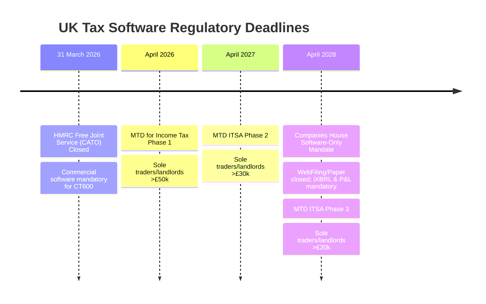

# Executive Summary: UK Micro-Entity Tax Filing Software Business Guide
*Prepared for Muhammad Bilal (Audited & Updated October 2026)*

---

## 1. Core Thesis & Strategic Window

The guide outlines the blueprint for launching a compliant, HMRC-recognised UK tax-filing SaaS targeting micro-entity private limited companies (FRS 105).

### Verified Regulatory Timelines (2026–2028)

1. **HMRC Free Joint Filing (CATO) Closed (31 March 2026)**: Forced companies that filed their own CT600 online onto commercial filing software.
2. **Companies House Software-Only Mandate (Confirmed: 1 April 2028)**: Companies House will close WebFiling and paper accounts filing on 1 April 2028, requiring all accounts to be submitted via software in **iXBRL** with a Profit & Loss statement.

---

## 2. Realistic Bottom-Up Market Sizing

* **Total Active UK Companies**: ~4.87 million.
* **Realistic Addressable Segment**:
  * An estimated **150,000 to 250,000 micro-entities** are cost-conscious, owner-managed, unrepresented (or bookkeeper-managed), and directly displaced by the closure of HMRC's free joint filing portal.
  * At £49/year, this represents a serviceable annual recurring software market of **£7.5M to £12.2M**.

---

## 3. Financial Realism & Unit Economics

* **Retail Price**: £49.00 (net of VAT)
* **Variable Costs per Customer**:
  * Stripe Processing (1.5% + 20p): £0.94
  * AWS London Compute & Storage: £0.80
  * AI OCR / Parsing API calls: £0.45
  * Customer Support (0.2 hrs @ £15/hr): £3.00
  * **Net Contribution Margin**: **£43.81 (89.4%)**
* **Annual Fixed Operating Overhead**:
  * PI & Cyber Insurance: £2,000
  * Penetration Test (CREST audit): £1,500 (amortised)
  * AWS Base Infrastructure: £1,200
  * Legal Opinion (MLR & ToS): £1,000 (amortised)
  * Companies House & ICO: £152
  * Domain & Software Tooling: £200
  * **Total Fixed Cash Burn**: **£6,052 / year**
* **True Breakeven**: **139 paying customers per year** (achievable within weeks of official GOV.UK listing).

---

## 4. Operating Model & Regulatory Perimeter

| Dimension | Model A: Pure Self-Filer Platform (Launch Core) | Model B: Practice / Agent Filer |
| :--- | :--- | :--- |
| **User Role** | Company Director files directly | Accountant / Agent files on client's behalf |
| **Credentials Used** | User's own HMRC Gateway & CH Auth Code | HMRC Agent Services Account (ASA) |
| **MLR 2017 Position** | Pure software vendor; outside standard accountancy perimeter (Formal legal opinion required prior to launch) | Full AML supervision mandatory (£300 setup + £400/yr + KYC audits) |
| **ECCTA ACSP Regime** | Exempt for director self-filers | Will require ACSP registration (slated for no earlier than late 2026/2027) |
| **Recommendation** | **Launch here strictly.** Lowest compliance friction. | Introduce as secondary tier post-launch. |

---

## 5. Implementation Roadmap (24 Weeks / 6 Months)

* **Weeks 1–4**: FRS 105 Core Math (Integer pence), Date-gated s455, Capital Allowance routing, C14N IRmark Hasher.
* **Weeks 5–8**: 6-Step Accruals Ingestion Wizard, Universal Bank CSV Normalizer, Companies House Deep Sync, Eligibility Gate.
* **Weeks 9–14**: HMRC SDST Local Test Service (LTS) & ETS Testing Track (Vendor ID), Companies House XML Gateway TIS v5.9 testing track.
* **Weeks 15–18**: Next.js 15 UI, 40-Point Pre-Flight Rejection Shield, HMRC Error Code Translator, Dual-Gateway Idempotent Workers.
* **Weeks 19–21**: AWS London Infrastructure, CREST Penetration Testing, Legal Opinion, ICO Registration.
* **Weeks 22–24**: HMRC Production Sign-Off, GOV.UK Commercial Supplier Listing, Commercial Launch.
