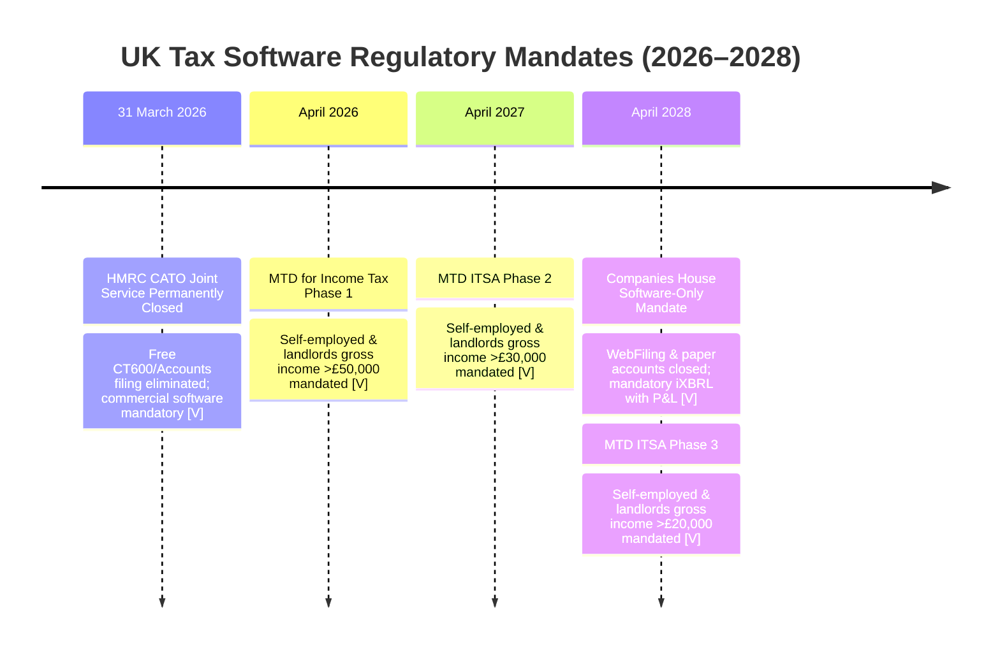
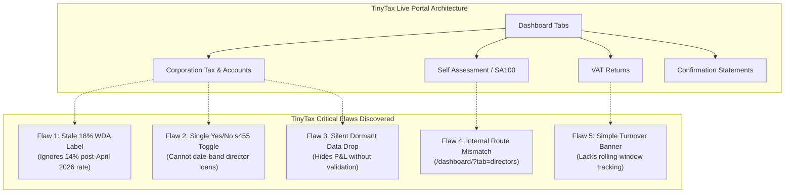
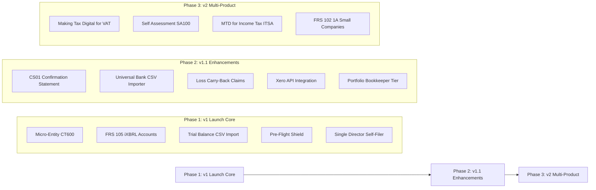
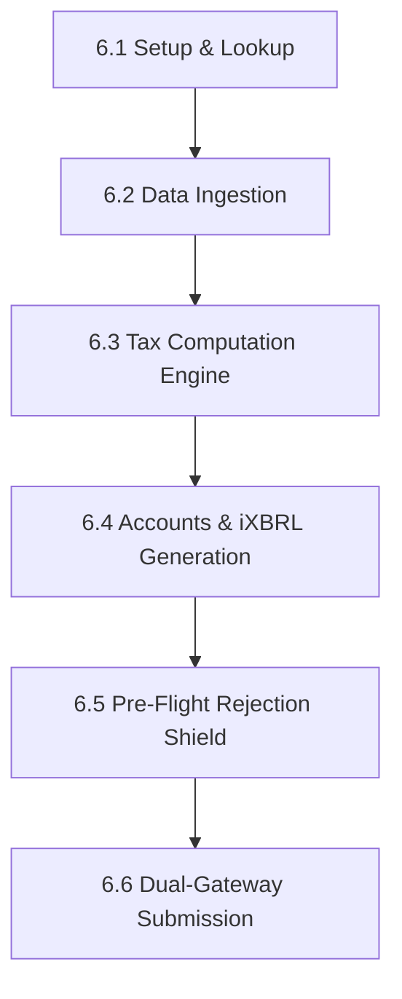
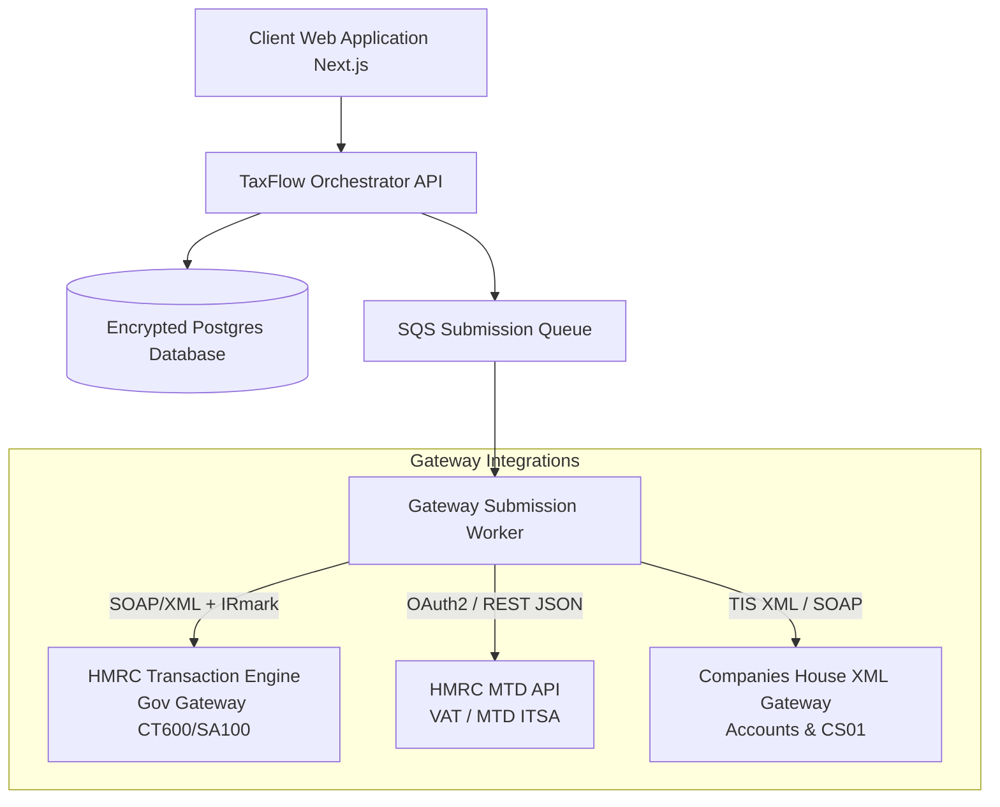
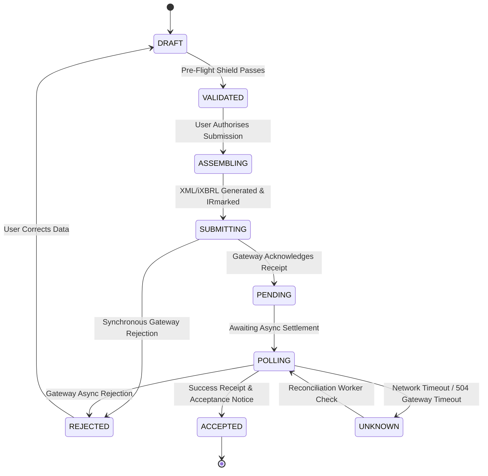

# TaxFlow UK — Master Product Requirements Document (PRD)
**Single Authoritative Engineering Build Specification & Regulatory Blueprint**

- **Product:** UK Micro-Entity & Small Business Tax Filing Platform (HMRC CT600, FRS 105 Accounts, MTD VAT, SA100 / MTD ITSA, CS01)
- **Version:** v5.0 Master Edition (Consolidated & Audited)
- **Prepared For:** Muhammad Bilal / Bilal Jabbar & Product Engineering
- **Effective Date:** October 2026 (Reflecting Autumn Budget, 2026/27 Tax Updates & Live Competitor Portal Teardowns)
- **Status:** Master Single Source of Truth (Approved for Gate-Driven Build)
- **Supersedes:** `UK-Tax-Filing-Platform-PRD v2.docx` (v1.0/v2.0) and `PRODUCT_REQUIREMENTS_DOCUMENT_v4.md` (v4.1)

---

## Document Taxonomy & Notation Rules

Every regulatory fact, parameter, and requirement in this document carries an evidence tag:
- **`[V]` Verified**: Verified against primary statutory sources, HMRC official technical specifications, or Companies House API documentation as of October 2026.
- **`[A]` Assumption / Target**: Operational or strategic target requiring empirical validation during beta or user testing.
- **`[VR-nn]` Verification Register Item**: Explicit open compliance/technical question tracked in Section 11. Must be formally closed before gateway submission code goes live.

> [!IMPORTANT]
> **Engineering Rule on Tax Parameters**: Tax rates, allowances, thresholds, and statutory copy are **versioned data objects with effective date ranges**, NEVER hardcoded constants buried inside application logic.

---

## 1. Executive Summary & Strategic Window

### 1.1 The Core Thesis
TaxFlow UK provides an automated, mathematically rigorous, self-filing compliance platform enabling UK micro-entity directors, sole traders, and bookkeepers to generate, validate, tag in iXBRL, and submit statutory company accounts and tax returns directly to HMRC and Companies House without costly accountancy fees.

### 1.2 Regulatory Deadlines & Tailwind (2026–2028)



1. **HMRC Free Joint Service (CATO) Closure (31 March 2026)**: HMRC permanently decommissioned its free online joint filing tool `[V]`. Every active UK limited company that previously filed for free is legally compelled to purchase commercial software or hire an accountant.
2. **Companies House Software-Only Mandate (Confirmed: 1 April 2028)**: Under the *Economic Crime and Corporate Transparency Act 2023 (ECCTA)*, Companies House confirmed it will close WebFiling and paper accounts filing on 1 April 2028 `[V]`. Micro-entities will be legally required to submit accounts via software in **iXBRL format** and must include a Profit & Loss statement (ending the filing of completely "filleted" accounts without P&L).
3. **Making Tax Digital for Income Tax (MTD ITSA)**: Staggered rollout starting April 2026 (>£50k), April 2027 (>£30k), and April 2028 (>£20k), replacing annual self-assessment with four quarterly digital submissions and an annual Final Declaration `[V]`.

### 1.3 Bottom-Up Market Sizing
- **Total Active UK Companies**: ~4.87 million registered companies `[V]`.
- **Target Micro-Entity SAM**: 150,000 to 250,000 unrepresented, cost-conscious, owner-managed private limited companies directly displaced by HMRC's CATO closure `[V]`.
- **Serviceable Annual Recurring Market**: At £49/year, the direct micro-entity CT600 niche represents **£7.5M to £12.2M** in addressable ARR, expanding significantly with MTD VAT (£29) and Self Assessment (£29).

### 1.4 Financial Realism & Audited Unit Economics
- **Retail Price**: £49.00 net per filing (under UK VAT registration threshold; £0 VAT remitted).
- **Variable Costs per Customer**:
  - Stripe Merchant Processing (1.5% + 20p): £0.94
  - AWS London (eu-west-2) Compute, Serverless & Storage: £0.80
  - OCR / Bank Ingestion / LLM Extraction APIs: £0.45
  - Customer Support Allocation (0.2 hrs @ £15/hr blended): £3.00
  - **Total Variable Cost**: **£5.19**
  - **Net Contribution Margin**: **£43.81 (89.4%)**
- **Annual Fixed Operating Overhead**:
  - Professional Indemnity & Cyber Insurance (£1M limit): £2,000
  - CREST Penetration Testing (annual audit): £1,500 (amortised)
  - AWS Base VPC & Gateway Infrastructure: £1,200
  - Legal & MLR Regulatory Opinions: £1,000 (amortised)
  - Companies House & ICO Data Protection Fees: £152
  - Core Developer Tooling & DNS: £200
  - **Total Fixed Annual Cash Burn**: **£6,052**
- **True Breakeven**: **139 paying customers per year** (achieved within 3–4 weeks of official GOV.UK commercial software listing).

### 1.5 Operating Model & Regulatory Perimeter

| Regulatory Dimension | Model A: Pure Self-Filer Platform (Launch Core) | Model B: Practice / Supervised Agent Filer |
| :--- | :--- | :--- |
| **User Role** | Company Director files directly for own company | Accountant / Bookkeeper files on client's behalf |
| **Gateway Credentials** | User's own Government Gateway & CH Auth Code | HMRC Agent Services Account (ASA) |
| **MLR 2017 Status** | **Pure Software Vendor**: Outside scope of Money Laundering Regulations 2017 (no TCSP or ASP supervision needed) `[V]` | **Supervised Entity**: Full AML supervision mandatory via HMRC/professional body (£300 setup + £400/yr + client KYC) `[V]` |
| **ECCTA ACSP Regime** | **Exempt**: Directors filing for their own company do not need Authorised Corporate Service Provider status `[V]` | **Mandatory ACSP**: Agent must register as ACSP and verify client identity before filing `[V]` |
| **Strategic Stance** | **Launch strictly here.** Lowest compliance friction, zero supervisory overhead. | Deferred to Phase 4 (v1.1/v2 Accountant Tier) after formal legal clearance. |

---

## 2. Competitive Intelligence: The TinyTax Teardown

On 15 October 2026, an exhaustive architectural and functional teardown of primary competitor **TinyTax** was conducted against a live production entity (**DROPLOGICX LTD**, CRN `15152081`, sole director Muhammad Saif Raza).



### 2.1 Teardown Findings by Module
1. **Corporation Tax & Accounts**:
   - Offers four company types: *Trading*, *Property*, *Dormant*, *Mixed Income*.
   - Generates four post-calculation artifacts: Full Accounts (with P&L), Filleted Accounts (iXBRL for Companies House), Tax Computations (for HMRC), and CT600 Form layout.
   - Requires manual entry of Company UTR, Government Gateway User ID, Password, and Companies House 6-character Authentication Code.
2. **Self Assessment (SA100)**:
   - Organised by person (director/shareholder) rather than company.
   - Correctly implements dividend top-slice stacking over salary (tested with £30k salary + £20k dividend: Personal Allowance £12,570 applied to salary, basic rate band used, dividend taxed at basic dividend rate after £500 allowance).
   - Rate note: Displayed 8.75% for 2025/26 tax year (correct for 2025/26, but will require 10.75% for 2026/27).
3. **VAT Returns**:
   - Persistent global warning banner triggered when company turnover exceeds £90,000 threshold.
   - Single inline 9-digit VRN entry.
   - Module entry gated behind VRN presence.
4. **Confirmation Statements (CS01)**:
   - Tracks 14-day filing window after annual statement date (e.g., statement date 19/09/2027, deadline 03/10/2027).
   - Gates filing form until statement date is reached.

### 2.2 Exploitable Competitor Vulnerabilities & TaxFlow UK Moats

| TinyTax Vulnerability (Observed Oct 15, 2026) | TaxFlow UK Architecture Moat |
| :--- | :--- |
| **Stale Capital Allowances (WDA)**: Main Pool WDA is labelled and computed at 18%, ignoring the statutory reduction to **14% effective 1 April 2026**. Straddling periods are miscalculated. | **Dynamic Hybrid WDA Engine**: Automatically calculates exact time-weighted hybrid WDA rates for periods straddling 1 April 2026 (`engine/ct_engine.ts`). |
| **Oversimplified s455 Director's Loans**: TinyTax uses a single `Yes/No` toggle. Cannot record individual loan dates or calculate multi-rate s455 tax across rate changes (33.75% vs 35.75%). | **Loan-by-Loan Ledger**: Captures loan creation date and repayment date for each advance, applying exact statutory rate bands (25%, 32.5%, 33.75%, 35.75%). |
| **Silent Dormant Data Dropping**: Switching company type to "Dormant" hides P&L fields without validating or warning if transaction figures were already entered. | **Strict State Validation Shield**: Detects conflicting transaction data on mode switch; requires explicit director confirmation to clear or reclassify. |
| **Crypto-Error Gateway Rejections**: TinyTax passes through raw HMRC/Companies House XML error strings to users without context. | **Plain-English Error Translator**: Maps every gateway error code (e.g. HMRC 3001, 1046; CH 9999) to human-readable explanations and 1-click remediation. |
| **No Pre-Submission Mathematical Shield**: Silent reconciliation errors between Balance Sheet Net Assets and P&L Retained Profit slip through to gateway submission. | **40-Point Pre-Flight Rejection Shield**: Validates double-entry balancing, iXBRL tag completeness, and period dates before payment or submission. |

---

## 3. Product Vision, Personas & Phased Scope

### 3.1 Target Personas
- **P1: Freelance/Contractor Director (Primary)**: Sole director of a service company (IT, consulting, creative). Low transaction volume (~50–200 txns/yr). Needs fast, foolproof filing without accounting jargon.
- **P2: E-Commerce / Marketplace Director**: Sells on Shopify/Amazon. Deals with inventory, marketplace fee deductions, and payment gateways. Needs CSV statement reconciliation.
- **P3: Dormant / Holding Company Director**: Zero or near-zero trading activity. Needs nil-return filing at lowest possible price point in under 5 minutes.
- **P4: Portfolio Bookkeeper / Small Practice (v1.1)**: Manages 10–50 micro-entity clients. Needs multi-client dashboard, bulk status tracking, and exportable reports.

### 3.2 Core Architectural Principles
1. **Deterministic Tax, Assisted Data**: Tax math is 100% deterministic, governed by versioned statutory tables and integer arithmetic. AI is strictly confined to OCR parsing and category suggestions; AI NEVER computes tax or alters balances.
2. **Explain Before You Submit**: Every line on the CT600, Balance Sheet, and P&L can be drilled down to source ledger transactions.
3. **Fail Early & Pre-Emptively**: Block submissions on fatal errors, warn on anomalies, and translate gateway rejection codes into plain English.
4. **Honest Scope**: Hard rejection at onboarding for entities exceeding micro-entity limits, groups, charities, or complex financial instruments.

### 3.3 Phased Implementation Scope



---


## 4. Accounting Foundations & Double-Entry Integrity (Rule 3.0)

Every valid statutory filing relies on the core mathematical foundation of double-entry bookkeeping. A balance sheet has two sides that must balance to the exact integer penny: **what the company owns and is owed must equal what the company owes and its equity**.

### 4.1 The Fundamental Balance Sheet Equation
$$	ext{Total Assets} - 	ext{Total Liabilities} = 	ext{Net Assets} \equiv 	ext{Total Shareholders' Funds (Equity)}$$

In FRS 105 Micro-Entity reporting format:
$$	ext{Fixed Assets} + 	ext{Current Assets} - 	ext{Creditors: amounts falling due within one year} - 	ext{Creditors: amounts falling due after more than one year} - 	ext{Provisions for Liabilities} = 	ext{Called Up Share Capital} + 	ext{Profit and Loss Account (Reserves)}$$

### 4.2 The Link Between Profit & Loss and the Balance Sheet
The Profit and Loss account is not an isolated report; it is the mathematical bridge that explains the change in the Balance Sheet's Retained Earnings between periods:
$$	ext{Retained Earnings (Closing)} = 	ext{Retained Earnings (Opening)} + 	ext{Net Profit/(Loss) After Tax (Current Period)} - 	ext{Dividends Declared & Paid}$$

### 4.3 Worked Example: DropLogicX Ltd Filed Accounts Reconciliation

```
Opening Balance Sheet (Prior Year Closing):
  Called Up Share Capital:                           £      100
  Retained Earnings (P&L Reserve b/fwd):             £   15,200
  Total Shareholders' Funds:                         £   15,300

Current Year Profit & Loss:
  Turnover:                                          £  100,000
  Cost of Sales & Administrative Expenses:          (£   77,731)
  Operating Profit:                                  £   22,269
  Corporation Tax Expense (Box 440):                (£    6,061)
  Profit for the Financial Year (After Tax):         £   16,208

Dividends Declared & Paid During Year:              (£   10,000)

Closing Balance Sheet Reconciliation:
  Called Up Share Capital:                           £      100
  Retained Earnings (£15,200 + £16,208 - £10,000):   £   21,408
  Total Shareholders' Funds (Must match Net Assets): £   21,508
```

### 4.4 The Trap Mechanical Checks Cannot Catch
A software validation check confirming $	ext{Net Assets} = 	ext{Total Equity}$ guarantees mathematical balance, but **does not guarantee compliance or correct tax**:
1. **Misclassification of Expenses as Assets**: Capitalising an operational repair inflates assets and overstates profit, causing overpayment of Corporation Tax.
2. **Disallowable Expenditure**: Paying for client entertaining out of the bank account reduces cash and reduces accounting profit cleanly, but **must be added back** on the CT600 tax computation.
3. **Dividends vs Director Remuneration**: Paying an illegal dividend when retained profits are negative or failing to run PAYE on regular director salary draws.

The platform must explicitly guide users through these classification boundaries.

---

## 5. The Master Statutory Tax & Filing Rulebook

This section contains the harmonized rule catalogue. Every rule number (`Rule 3.x.x`) maps 1:1 to regulatory statutes and aligns with the developer walkthroughs.

### 5.1 Rule 3.1: Corporation Tax (CT600) & Computations

#### Rule 3.1.1 Corporation Tax Rates (FY2023 Onward)
Corporation tax is charged by UK Financial Year (FY runs 1 April to 31 March). For FY2023, FY2024, FY2025, FY2026, and FY2027:
- **Small Profits Rate**: **19%** on augmented profits up to the Lower Limit ($L = £50,000$).
- **Main Rate**: **25%** on augmented profits exceeding the Upper Limit ($U = £250,000$).
- **Marginal Relief Band**: Tapered rate on profits between $L$ and $U$.

#### Rule 3.1.2 Statutory Marginal Relief Formula
Where augmented profits ($A$) fall between Lower Limit ($L$) and Upper Limit ($U$), Corporation Tax payable is calculated as Main Rate tax less Marginal Relief ($MR$):
$$CT = \left(TTP 	imes 25\%
ight) - MR$$
$$MR = 	ext{Marginal Fraction} 	imes (U - A) 	imes rac{TTP}{A}$$
- **Marginal Fraction**: Exactly $rac{3}{200}$ ($0.015$).
- **$TTP$**: Total Taxable Profits (trading profit after capital allowances and loss relief, plus non-trading income).
- **$A$ (Augmented Profits)**: $TTP + 	ext{Exempt Franked Investment Income (FII)}$, where FII represents dividends received from non-group UK companies.

#### Rule 3.1.3 Period Length and Associated Companies Scaling
The limits $L$ and $U$ are legally scaled by two factors:
$$L = rac{£50,000 	imes rac{	ext{Days in Accounting Period}}{	ext{Days in Financial Year (365 or 366)}}}{N + 1}$$
$$U = rac{£250,000 	imes rac{	ext{Days in Accounting Period}}{	ext{Days in Financial Year (365 or 366)}}}{N + 1}$$
where $N$ is the number of **Associated Companies** worldwide (statutory test under CTA 2010 s18E; $N=0$ for a single standalone company).

#### Rule 3.1.4 Worked Tax Calculations Across Profit Bands
*(All calculations assume full 365-day period, $N=0$, and £0 FII)*

| Taxable Profit ($TTP$) | Effective Rate | Marginal Relief ($MR$) | Corporation Tax Due | CT600 Box Entries |
| :--- | :--- | :--- | :--- | :--- |
| **£30,000** | 19.00% | £0.00 | **£5,700.00** | Box 315: £30k @ 19% = Box 440: £5,700 |
| **£50,000 (Boundary $L$)** | 19.00% | £0.00 | **£9,500.00** | Box 315: £50k @ 19% = Box 440: £9,500 |
| **£100,000** | 22.75% | £2,250.00 | **£22,750.00** | Box 330: £100k @ 25% (£25k) - Box 435: £2,250 = Box 440: £22,750 |
| **£250,000 (Boundary $U$)** | 25.00% | £0.00 | **£62,500.00** | Box 330: £250k @ 25% = Box 440: £62,500 |
| **£300,000** | 25.00% | £0.00 | **£75,000.00** | Box 330: £300k @ 25% = Box 440: £75,000 |

#### Rule 3.1.5 Accounting Period Splitting & Leap Years
- Under CTA 2009 s9, an accounting period for Corporation Tax **cannot exceed 12 months (365 or 366 days)**.
- If a company's period of accounts exceeds 12 months (e.g. an initial long period of 15 March 2025 to 31 March 2026 = 382 inclusive days), the software must automatically split it into **two separate CT600 returns**:
  - Period 1: First 12 months (15 March 2025 to 14 March 2026 = 365 days).
  - Period 2: Remainder (15 March 2026 to 31 March 2026 = 17 days).
- Both returns must be linked to the single set of statutory annual accounts covering the 382-day period.

#### Rule 3.1.6 Payment Deadline vs Filing Deadline
- **Corporation Tax Payment Deadline**: Exactly **9 months and 1 day** after the end of the accounting period (e.g., period ending 31 March 2026 -> tax payment due **1 January 2027**).
- **CT600 Return Filing Deadline**: Exactly **12 months** after the end of the accounting period (e.g., period ending 31 March 2026 -> filing due **31 March 2027**).
- *Critical UX Guardrail*: The payment deadline precedes the filing deadline by 3 months. The software must prominently display the payment deadline to prevent late-payment interest charges from HMRC.

#### Rule 3.1.7 Late Filing Penalties (CT600)
- 1 day late: Fixed **£100** penalty.
- 3 months late: Additional **£100** penalty (total £200).
- 6 months late: HMRC estimates tax and charges **10%** of unpaid tax.
- 12 months late: Additional **10%** of unpaid tax (total 20%).
- *Repeat Escalation*: If a company files late 3 consecutive times, fixed penalties increase from £100 to **£500** each.

#### Rule 3.1.8 Statutory Accounts Qualifications (FRS 105 Micro-Entity)
A company qualifies as a micro-entity under Companies Act 2006 s384A if it meets at least **2 out of 3** criteria for two consecutive financial years:
1. **Turnover**: Not more than **£1,000,000** (pro-rated for periods $
e 12$ months) `[V]`.
2. **Balance Sheet Total (Gross Assets)**: Not more than **£500,000** `[V]`.
3. **Average Number of Employees**: Not more than **10** `[V]`.

#### Rule 3.1.9 Capital Allowances Architecture & 2026/27 Rates
Depreciation recorded in the Profit & Loss is disallowable for tax purposes and added back. In its place, statutory Capital Allowances are claimed:
1. **Annual Investment Allowance (AIA)**: 100% first-year relief on qualifying plant and machinery up to **£1,000,000** per year (shared among associated companies). AIA cannot be claimed on cars.
2. **Main Pool Writing Down Allowance (WDA)**:
   - Prior to 1 April 2026: **18%**.
   - **Effective 1 April 2026**: Statutory rate permanently reduced to **14%** `[V]`.
   - **Hybrid Blended Rate**: For accounting periods straddling 1 April 2026, the rate is weighted by day count:
     $$	ext{Rate} = rac{(	ext{Days before 1 April 2026} 	imes 18) + (	ext{Days on/after 1 April 2026} 	imes 14)}{	ext{Total Days in Period}}$$
3. **Special Rate Pool WDA**: **6%** on long-life assets, thermal insulation, and cars with $CO_2 > 50	ext{ g/km}$.
4. **First-Year Allowance (FYA) on Cars**:
   - Zero-emission cars (0 g/km $CO_2$): **100% FYA** (date-gated to purchases up to **31 March 2027**).
   - Cars emitting 1–50 g/km $CO_2$: Main pool (14% WDA).
   - Cars emitting > 50 g/km $CO_2$: Special rate pool (6% WDA).
   - *Strict Guardrail*: Cars can NEVER claim AIA or Full Expensing.

#### Rule 3.1.10 Disallowable Expenses (Add-Backs)
The following expenses must be added back to accounting profit to arrive at taxable trading profit:
- Depreciation and amortisation charges.
- Business entertaining of clients, prospects, or suppliers (staff entertaining up to statutory limits is allowable).
- Fines and penalties (HMRC penalties, parking tickets, driving fines, late filing fines).
- Political donations.
- Capital expenditure expensed directly to P&L.

#### Rule 3.1.11 Full Bridge: Accounting Profit to Taxable Trading Profit
```
  Accounting Net Profit before Tax:                 £  25,000
  Add: Depreciation:                               +£   2,500
  Add: Client Entertaining:                         +£     800
  Add: Fines & Penalties:                           +£     150
  Less: Capital Allowances Claimed (AIA + WDA):     -£   4,000
  Adjusted Taxable Trading Profit:                  £  24,450
  Add: Bank Interest Received (Non-Trading Income): +£     200
  Less: Brought-Forward Trading Losses Utilised:    -£   2,000
  Total Taxable Profits (TTP):                      £  22,650
```

#### Rule 3.1.12 Trading Losses & Relief
- **Current Year Loss**: Can be set off against total non-trading profits (e.g. bank interest) of the same period.
- **Carry-Forward Loss (Post-1 April 2017 rules)**: Carried forward automatically against future total taxable profits (up to the £5M deductions allowance). Loss cannot be lost or discarded.
- **Carry-Back Loss (v1.1)**: Carry back against taxable profits of the preceding 12 months (requires formal claim).

#### Rule 3.1.13 Director's Loan Account (DLA) & Section 455 Tax
When a close company makes a loan or advance to a director or participator that remains unpaid **9 months and 1 day** after the accounting period end, Section 455 CTA 2010 imposes a temporary tax charge payable on the CT600A:
1. **Loan-by-Loan Statutory Rates** (fixed by the date the loan was made):
   - Loans made between 6 April 2016 and 5 April 2022: **32.50%**
   - Loans made between 6 April 2022 and 5 April 2026: **33.75%**
   - **Loans made on or after 6 April 2026**: **35.75%** `[V]` (aligned with dividend upper rate).
2. **Bed & Breakfasting Anti-Avoidance (30-day rule)**: Repayments of £5,000+ matched with redrawn amounts within 30 days are disregarded for relief.
3. **Relief Under Section 458**: Tax is repayable by HMRC, but ONLY **9 months and 1 day after the end of the accounting period in which the loan was repaid**, NOT immediately upon repayment.

---

### 5.2 Rule 3.2: Companies House Accounts (FRS 105)

#### Rule 3.2.1 Statutory Micro-Entity Financial Statements
Accounts filed under FRS 105 must include:
1. **Balance Sheet**: Disclosing Fixed Assets, Current Assets, Prepayments, Creditors falling due within one year, Net Current Assets, Total Assets less Current Liabilities, Creditors falling due after more than one year, Provisions, and Capital & Reserves.
2. **Profit and Loss Account**: Showing Turnover, Other Income, Cost of Raw Materials, Staff Costs, Depreciation, Other Charges, Tax, and Profit/(Loss).
3. **Mandatory Audit Exemption Declarations (Companies Act 2006 s475/s477)**:
   - The company is entitled to audit exemption under section 477 for the year ending [Date].
   - The members have not required the company to obtain an audit under section 476.
   - The directors acknowledge their responsibilities for complying with the requirements of the Act with respect to accounting records and the preparation of accounts.
   - These accounts have been prepared in accordance with the micro-entity provisions.
4. **Director Approval**: Must state the printed name of the approving director and the date of board approval.

#### Rule 3.2.2 The ECCTA Mandate (Mandatory P&L & Software Filing)
Under ECCTA 2023, the option for micro-entities to file "filleted accounts" that omit the Profit & Loss statement is eliminated. Both HMRC and Companies House will receive the Profit & Loss account. Full digital software filing becomes mandatory on **1 April 2028**.

---

### 5.3 Rule 3.3: Value Added Tax (VAT - Making Tax Digital)

#### Rule 3.3.1 VAT Rates & Supply Classifications
- **Standard Rate (20%)**: Default for commercial goods and consulting/IT services.
- **Reduced Rate (5%)**: Domestic utilities, energy-saving materials.
- **Zero-Rated (0%)**: Books, newspapers, most foodstuffs, public transport. *Note: Zero-rated supplies ARE taxable supplies and MUST be included in Box 6 sales.*
- **Exempt Supplies**: Financial services, insurance, medical care, postal services. *Note: Exempt supplies fall OUTSIDE VAT and are EXCLUDED from Box 6.*

#### Rule 3.3.2 Registration & Deregistration Thresholds
- **Mandatory Registration**:
  - **Rolling 12-Month Test**: Cumulative taxable turnover at the end of any calendar month exceeds **£90,000** `[V]`. Must register within 30 days of the month end.
  - **Forward 30-Day Test**: Real expectation that taxable turnover in the next 30 days alone will exceed **£90,000**. Must register immediately.
- **Deregistration**: Taxable turnover drops below **£88,000** `[V]`.

#### Rule 3.3.3 Making Tax Digital (MTD) Digital Links Mandate
- HMRC MTD regulations strictly prohibit manual copy-pasting, manual keyboard transcription, or manual re-typing of digital data between accounting ledgers and the VAT submission tool.
- Data must flow via automated digital links: API connection, direct CSV/XLSX import, or automated formula linking.

#### Rule 3.3.4 Filing Periods & Statutory Deadlines
- Standard VAT periods are quarterly.
- **Submission & Payment Deadline**: Exactly **1 calendar month and 7 days** after the end of the quarterly period (payment must be cleared funds in HMRC's account).

#### Rule 3.3.5 Flat Rate Scheme (FRS) Rules
- Eligibility: Expected taxable turnover under **£150,000** net; must leave if turnover exceeds **£230,000**.
- First year discount: **1% reduction** on the sector rate during the first 12 months of VAT registration.
- **Limited Cost Business Test**: If expenditure on relevant goods (excluding motoring and capital items) is less than **2% of turnover** or less than **£1,000/year**, the flat rate is automatically forced to **16.5%**, eliminating FRS tax advantages for IT contractors and consultants.

#### Rule 3.3.6 The 9-Box MTD VAT Return
- **Box 1**: VAT due on sales and other outputs (to the penny).
- **Box 2**: VAT due on acquisitions from EU Member States to Northern Ireland (to the penny).
- **Box 3**: **Total VAT due** = $	ext{Box 1} + 	ext{Box 2}$ (to the penny).
- **Box 4**: VAT reclaimed on purchases and expenses (to the penny).
- **Box 5**: **Net VAT payable or refundable** = $|	ext{Box 3} - 	ext{Box 4}|$ (to the penny).
- **Box 6**: Total value of sales and all other outputs excluding VAT (**Whole pounds only, round-half-up**).
- **Box 7**: Total value of purchases and expenses excluding VAT (**Whole pounds only, round-half-up**).
- **Box 8**: Total value of goods supplied to EU Member States from Northern Ireland (**Whole pounds only**).
- **Box 9**: Total value of goods acquired from EU Member States to Northern Ireland (**Whole pounds only**).

---

### 5.4 Rule 3.4: Income Tax, Dividends & Self Assessment (SA100)

#### Rule 3.4.1 Income Tax Bands (2025/26 & 2026/27)
- **Personal Allowance**: **£12,570** (0% tax).
  - *Taper Mechanism*: Personal Allowance is reduced by £1 for every £2 of adjusted net income over **£100,000**, reaching zero at **£125,140**.
- **Basic Rate Band (20%)**: £12,571 to £50,270 (£37,700 band width).
- **Higher Rate Band (40%)**: £50,271 to £125,140 (£74,870 band width).
- **Additional Rate Band (45%)**: Over £125,140.

#### Rule 3.4.2 Self-Employed National Insurance Contributions
- **Class 2 NIC**: Abolished for compulsory payment; voluntary contributions available for state pension credit.
- **Class 4 NIC**:
  - Profits between Lower Profits Limit (£12,570) and Upper Profits Limit (£50,270): **6%** `[V]`.
  - Profits above £50,270: **2%** `[V]`.

#### Rule 3.4.3 Self Assessment Deadlines & Payments on Account
- **Filing Deadlines**: Paper returns: 31 October; Online returns: **31 January** following the end of the tax year.
- **Payments on Account (POA)**: Triggered if tax due exceeds **£1,000** (unless >80% was collected at source via PAYE).
  - 1st Payment on Account: Due **31 January** (50% of prior year's liability).
  - 2nd Payment on Account: Due **31 July** (50% of prior year's liability).

#### Rule 3.4.4 Dividend Tax Stacking & Statutory Ordering
Dividends are legally treated as the **top slice of income**. Income is stacked sequentially:
1. Non-savings income (Salary, PAYE, trading profits) absorbs the Personal Allowance first, then fills the Basic, Higher, and Additional rate bands.
2. Savings income absorbs remaining personal allowance, then savings allowance, then remaining band space.
3. **Dividends stack on top**:
   - The first **£500** of dividend income is covered by the **Dividend Allowance** (taxed at 0%, but absorbs band capacity).
   - Remaining dividends in Basic Rate Band:
     - 2025/26 tax year: **8.75%**
     - **2026/27 tax year onward**: **10.75%** `[V]` (Autumn Budget increase).
   - Remaining dividends in Higher Rate Band:
     - 2025/26 tax year: **33.75%**
     - **2026/27 tax year onward**: **35.75%** `[V]`.
   - Remaining dividends in Additional Rate Band: **39.35%** (unchanged).

#### Rule 3.4.5 Director Remuneration & Payroll Class 1 Thresholds
- Secondary Threshold (Employer's NIC threshold): £9,100/yr (£175/wk).
- Primary Threshold (Employee's NIC threshold): £12,570/yr (£242/wk).
- Optimal Director Salary: Structuring salary at the Secondary Threshold (£9,100) or Primary Threshold (£12,570) maximizes Corporation Tax deductions while maintaining zero or minimal National Insurance liabilities.

---

### 5.5 Rule 3.5: Making Tax Digital for Income Tax (MTD ITSA)

#### Rule 3.5.1 Mandated Rollout Schedule
- **6 April 2026**: Mandatory for sole traders and landlords with qualifying gross income **over £50,000** `[V]`.
- **6 April 2027**: Mandatory for qualifying gross income **over £30,000** `[V]`.
- **6 April 2028**: Mandatory for qualifying gross income **over £20,000** `[V]`.

#### Rule 3.5.2 Quarterly Submission Windows
1. **Quarter 1** (6 April – 5 July): Deadline **7 August**.
2. **Quarter 2** (6 July – 5 October): Deadline **7 November**.
3. **Quarter 3** (6 October – 5 January): Deadline **7 February**.
4. **Quarter 4** (6 January – 5 April): Deadline **7 May**.
5. **Final Declaration & EOPS**: Due **31 January** following the tax year.

---

### 5.6 Rule 3.6: Confirmation Statements (CS01)
- **Filing Interval**: Must be delivered at least once every 12 months, within **14 days** of the review date `[V]`.
- **Companies House Fee**: **£50.00** online filing fee (effective 1 February 2026) `[V]`.
- **Confirmed Information**: Directors, Company Secretary, Persons with Significant Control (PSCs), Registered Office Address, Registered Email Address, SIC Codes, Statement of Capital, Shareholder List.
- **ECCTA Identity Verification**: Directors and PSCs must have their identity verified via Companies House IDV service prior to confirmation.

---

### 5.7 Rule 3.7: Data Protection & ICO Compliance (UK GDPR)
- Registered with the Information Commissioner's Office (ICO) under Data Protection Regulations (Tier 1 fee: £40/year).
- Financial ledger records retained for **6 statutory years** (plus current year) under TMA 1970 s12B and Companies Act 2006 s386.
- Strict data sovereignty: All user data, backups, and transaction logs stored within AWS London (`eu-west-2`).

---

### 5.8 Rule 3.8: Anti-Money Laundering (MLR 2017) & ECCTA ACSP Perimeter
- **Model A (Launch Core)** operates strictly as a software tool vendor enabling taxpayer direct self-filing. The platform never acts as an Accountancy Service Provider (ASP) or Trust or Company Service Provider (TCSP).
- No agent credentials or filing delegations are held in Model A.
- Expansion to Model B (Accountant Tier) will strictly require HMRC AML registration and ACSP authorisation before general availability.


## 6. Functional Requirements & Acceptance Criteria

Every requirement is assigned a priority (**M** = Must Have for v1; **S** = Should Have for v1.1; **C** = Could Have for v2) and testable Acceptance Criteria (AC).



### 6.1 Company Setup, Lookup & Eligibility Gate

- **FR-01 Company Lookup via Companies House REST API (M, v1)**
  - *Description*: Users enter company name or 8-character CRN. The system retrieves legal name, registered office, incorporation date, accounting reference date (ARD), next accounts due date, next confirmation statement due date, and current officer roster.
  - *AC-01.1*: Display retrieved company profile and require explicit director confirmation before persisting to the workspace.
  - *AC-01.2*: If Companies House API is unavailable, gracefully degrade to manual company profile entry with format validation.

- **FR-02 Prior Period Accounts Comparative Extraction (M, v1)**
  - *Description*: Query Companies House API for prior period accounts. If filed in iXBRL, parse prior year closing figures (Share Capital, P&L Reserves, Fixed Assets, Current Assets, Creditors) into comparative columns.
  - *AC-02.1*: If prior year accounts are paper/PDF or extraction confidence is <100%, present a side-by-side comparative entry grid.
  - *AC-02.2*: Verify continuity: Opening balances for current period must equal prior period closing balances within £0.00.

- **FR-03 Micro-Entity Statutory Eligibility Gate (M, v1)**
  - *Description*: Enforce Companies Act 2006 s384A micro-entity limits (Turnover $\le$ £1M, Balance Sheet $\le$ £500k, Employees $\le$ 10).
  - *AC-03.1*: If 2 of 3 criteria are exceeded, or company is an excluded entity (charity, PLC, financial institution, part of an ineligible group), immediately block filing flow.
  - *AC-03.2*: Display clear explanation of ineligibility and do NOT process payments.

- **FR-04 Accounting Period Splitting Planner (M, v1)**
  - *Description*: Check period of accounts. If $>12$ months (e.g. 382 days for new incorporations), automatically split into 2 accounting periods per CTA 2009 s9.
  - *AC-04.1*: Period 1 is clamped to exactly 12 months; Period 2 covers the residual days.
  - *AC-04.2*: User is alerted that two linked CT600 returns will be submitted with one statutory set of accounts.

- **FR-05 Director Electronic Signature & Declaration Gate (M, v1)**
  - *Description*: Capture approving director's name, board approval date, and declaration checkbox before submission unlocked.
  - *AC-05.1*: Timestamp and audit-log director declaration with IP address and user ID.

---

### 6.2 Data Ingestion & Transaction Normalisation

- **FR-10 Universal Bank CSV Importer & Parser (S, v1.1)**
  - *Description*: Ingest CSV exports from major UK banks (Barclays, NatWest, Lloyds, Monzo, Starling, Revolut, HSBC).
  - *AC-10.1*: Auto-detect date format (`DD/MM/YYYY`, `YYYY-MM-DD`), amount sign conventions (Debit/Credit vs unified Amount), and description columns.
  - *AC-10.2*: Enforce deduplication against previously ingested transaction IDs or identical timestamp+amount hashes.

- **FR-11 Trial Balance CSV Ingestor (M, v1)**
  - *Description*: Direct upload of trial balance CSV from bookkeepers or spreadsheet templates.
  - *AC-11.1*: Enforce debits equal credits: $\sum 	ext{Debits} - \sum 	ext{Credits} = 0$.
  - *AC-11.2*: Auto-map standard chart of account codes to FRS 105 taxonomy buckets with manual override preview.

- **FR-12 Assisted Expense & Asset Classification (M, v1)**
  - *Description*: Interactive classification wizard guiding users through Disallowable Add-backs (entertaining, fines) and Capital Items (laptops, equipment, vehicles).
  - *AC-12.1*: AI suggestions require explicit user confirmation.
  - *AC-12.2*: Client entertaining is flagged and linked directly to CT600 add-back calculations.

---

### 6.3 Tax Computation Engine

- **FR-30 Deterministic Integer-Pence Tax Engine (M, v1)**
  - *Description*: Implement `engine/ct_engine.ts` as the core computation service. All monetary amounts represented and computed strictly as integer pence.
  - *AC-30.1*: Floating-point representations are strictly forbidden in computation pipelines.
  - *AC-30.2*: Pass 100% of the 22 unit tests in `engine/ct_engine.test.ts`.

- **FR-31 Dynamic Hybrid Capital Allowances Engine (M, v1)**
  - *Description*: Calculate AIA, Main Pool WDA (14% post-1 April 2026, day-weighted hybrid for straddling periods), Special Rate (6%), and FYA (100% zero-emission cars).
  - *AC-31.1*: Automatically apply formula: $(	ext{Days pre-Apr 26} 	imes 18 + 	ext{Days post-Apr 26} 	imes 14) / 	ext{Total Days}$.
  - *AC-31.2*: Hard block: prevent any motor vehicle from claiming AIA or Full Expensing.

- **FR-32 Loss Relief Allocation & Carry-Forward Ledger (M, v1)**
  - *Description*: Automatically offset trading loss against current year non-trading income (bank interest) if selected, and track remaining loss carried forward.
  - *AC-32.1*: Carried-forward losses are never dropped or silently cleared during loss-making years.
  - *AC-32.2*: Display cumulative loss carry-forward balance on the final computation sheet.

- **FR-33 Date-Banded Section 455 Director's Loan Ledger (M, v1)**
  - *Description*: Capture loan date and outstanding balance at statutory payment date (AP end + 9m 1d) for each individual loan to participators.
  - *AC-33.1*: Apply exact statutory rate corresponding to loan creation date: 32.5% (pre-6 Apr 2022), 33.75% (6 Apr 2022–5 Apr 2026), 35.75% (on/after 6 Apr 2026).
  - *AC-33.2*: Generate multi-line CT600A supplementary return for multi-loan scenarios.

- **FR-34 Marginal Relief & Associated Companies Scaling (M, v1)**
  - *Description*: Apply statutory marginal relief formula: $rac{3}{200} 	imes (U - A) 	imes rac{TTP}{A}$.
  - *AC-34.1*: Divide $L$ (£50k) and $U$ (£250k) by $(N+1)$ where $N$ is statutory associated companies count.
  - *AC-34.2*: Pro-rate limits for accounting periods shorter than 365 days.

---

### 6.4 Accounts Generation & iXBRL Tagging

- **FR-20 FRS 105 iXBRL Document Generation (M, v1)**
  - *Description*: Generate valid, well-formed inline XBRL (iXBRL) accounts documents compliant with HMRC and Companies House taxonomies.
  - *AC-20.1*: Must validate against the UK FRS 105 Taxonomy schema and DQC (Data Quality Committee) rules without error.
  - *AC-20.2*: Embed required mandatory tags: entity identifier (CRN), period start/end dates, balance sheet audit exemption statements, director approval signature, and currency (`GBP`).

- **FR-21 Four Artifact Production Suite (M, v1)**
  - *Description*: Produce the four standardized review documents observed in market leaders:
    1. Full Accounts (with Balance Sheet, P&L, Notes for shareholders).
    2. Filleted Accounts (iXBRL-ready accounts for Companies House).
    3. Tax Computations (detailed bridge schedule for HMRC).
    4. CT600 Return Layout (box-numbered PDF/print layout).
  - *AC-21.1*: All four artifacts generated asynchronously in $<15$ seconds with instant download links.

---

### 6.5 Pre-Flight Rejection Shield & Error Translation

- **FR-46 40-Point Pre-Flight Validation Shield (M, v1)**
  - *Description*: Automated validation suite executing prior to payment collection or gateway dispatch.
  - *AC-46.1*: Validate Balance Sheet Equation: $	ext{Net Assets} = 	ext{Total Shareholders' Funds}$.
  - *AC-46.2*: Validate Retained Earnings Reconciliation: $	ext{P&L closing} = 	ext{Opening} + 	ext{Profit} - 	ext{Dividends}$.
  - *AC-46.3*: Validate CT600 Box consistency: Box 440 matches Tax Computation sheet; Box 315/330 match TTP.
  - *AC-46.4*: Validate Company Status: Ensure company is not dissolved or in liquidation via Companies House live check.
  - *AC-46.5*: Validate Credentials: Check UTR (10 digits), CRN (8 chars), and Auth Code format.

- **FR-47 Plain-English Gateway Error Code Translator (M, v1)**
  - *Description*: Intercept raw XML gateway error codes and present actionable remediation instructions.
  - *AC-47.1*: Map HMRC Error `1046` ("Authentication Failure") to: *"Your Government Gateway User ID, password, or Company UTR does not match HMRC records. Ensure Online Corporation Tax is activated on your business tax account."*
  - *AC-47.2*: Map HMRC Error `3001` ("Schema validation failed") to specific tag and field remediation.
  - *AC-47.3*: Map Companies House Error `9999` / Auth Code failure to: *"Companies House Authentication Code invalid. Re-check your 6-character code from Companies House."*

---

### 6.6 VAT, Self Assessment & Confirmation Statement Modules

- **FR-36 MTD VAT 9-Box Engine & HMRC REST Integration (C, v2)**
  - *Description*: Generate 9-box VAT return from digital transaction links. Connect via HMRC OAuth2 API.
  - *AC-36.1*: Compute Box 1-5 to exact pence; round Boxes 6-9 to nearest whole pound (round-half-up).
  - *AC-36.2*: Support Flat Rate Scheme and enforce 16.5% Limited Cost Business override where applicable.

- **FR-40 Self Assessment SA100 & Dividend Stacking Engine (C, v2)**
  - *Description*: Annual SA100 tax return module for directors and sole traders.
  - *AC-40.1*: Implement sequential income stacking: Salary absorbs Personal Allowance and basic rate first; dividends stack as top slice with £500 allowance at 0%.
  - *AC-40.2*: Apply 8.75% basic dividend rate for 2025/26 and 10.75% for 2026/27 onward.

- **FR-43 CS01 Confirmation Statement Wizard (S, v1.1)**
  - *Description*: Annual confirmation statement module. Pre-fills directors, PSCs, registered address, share capital from Companies House API.
  - *AC-43.1*: Step-by-step confirmation of the 6 statutory categories.
  - *AC-43.2*: Submit via Companies House XML Gateway with £50 statutory fee processing.

---

## 7. Dual-Gateway Submission Architecture & State Machine

TaxFlow UK interacts with two distinct UK government gateways possessing fundamentally different protocols and cryptographic requirements.



### 7.1 Gateway Comparison & Protocol Matrix

| Filing Type | Target Gateway | Protocol | Authentication | Cryptographic Hash |
| :--- | :--- | :--- | :--- | :--- |
| **Corporation Tax (CT600 + Accounts)** | HMRC Transaction Engine (LTS / Production) | XML over HTTPS / SOAP 1.1 | Government Gateway User ID + Password + Company UTR | **IRmark**: SHA-1 computed over canonicalised XML body (W3C C14N) `[V]` |
| **Companies House Accounts (FRS 105)** | Companies House XML Gateway (TIS v5.9) | XML over HTTPS | Presenter ID + Authentication Code + Company Number | XML Digest / Message Header Envelope `[V]` |
| **VAT Returns (MTD)** | HMRC MTD API Platform | RESTful JSON over HTTPS | OAuth 2.0 Bearer Token (User Delegated Access) | None (Transport Layer Security TLS 1.3) `[V]` |
| **Confirmation Statement (CS01)** | Companies House XML Gateway (TIS) | XML over HTTPS | Presenter ID + Authentication Code | XML Envelope Digest `[V]` |

### 7.2 Message Integrity: The Statutory IRmark Specification
Every CT600 XML submission must carry an **IRmark** generated strictly according to HMRC's technical specification:
1. Extract the `<Body>` element containing the CT600 tax return and iXBRL accounts.
2. Remove any pre-existing `<IRmark>` element.
3. Canonicalise the XML fragment using standard **W3C Canonical XML (C14N)** without comments.
4. Calculate the **SHA-1** cryptographic hash of the canonicalised bytes.
5. Base64-encode the resulting digest and insert it into the `<IRmark>` header field before submission.
6. The exact same IRmark string is returned in HMRC's digital acceptance receipt and must be displayed on the user's filing confirmation.

### 7.3 Per-Job Idempotent Submission State Machine

Every individual gateway submission is modeled as an isolated, idempotent asynchronous job:



#### State Definitions & Resilience Rules
- **`DRAFT`**: Financial and company data being entered and edited.
- **`VALIDATED`**: Passed the 40-point Pre-Flight Shield. Ready for director authorization.
- **`ASSEMBLING`**: Rendering iXBRL accounts, compiling CT600 XML, canonicalizing, and computing IRmark.
- **`SUBMITTING`**: Transmitting XML payload over TLS 1.3 to HMRC/Companies House gateway endpoint.
- **`PENDING`**: Gateway returned initial acknowledgment HTTP 200 with polling correlation token.
- **`POLLING`**: Background worker polling gateway status endpoint with exponential backoff (initial poll at 10s, doubling up to max 120s).
- **`ACCEPTED`**: Terminal success. Gateway returned official XML receipt containing timestamp and IRmark. Filing locked permanently.
- **`REJECTED`**: Terminal failure. Gateway rejected return. Translated error message and offending fields presented to user.
- **`UNKNOWN`**: Transient network partition or gateway timeout. **NEVER resubmit automatically** (prevents duplicate filing penalties). The reconciliation worker polls the gateway status using the existing submission token to determine true state.

---

## 8. Non-Functional Requirements, Security & Privacy

### 8.1 Performance & Reliability SLAs
- **UI Interaction Latency**: $<1.5$ seconds for all form navigations and calculations.
- **Document Generation Latency**: $<15$ seconds for full compilation of iXBRL accounts, CT600 PDF, and Tax Computation sheets.
- **System Availability**: $99.9\%$ uptime during standard working hours; $99.99\%$ uptime during the peak tax filing windows (25–31 January and 25–31 March).

### 8.2 Security Architecture & Credential Handling
- **Zero Plain-Text Credential Storage**: Government Gateway passwords and Companies House Authentication codes are processed in ephemeral server memory and **NEVER stored in persistent database tables**.
- **Encryption at Rest**: AES-256 encryption across all PostgreSQL database volumes, S3 document storage, and ledger tables.
- **Encryption in Transit**: Strict TLS 1.3 enforcement on all endpoints; HSTS headers preloaded.
- **CREST Penetration Testing**: Annual independent third-party penetration testing required prior to public commercial launch.

### 8.3 Data Sovereignty & UK GDPR
- All production infrastructure, primary databases, worker nodes, and backups are strictly hosted in the **AWS London Region (`eu-west-2`)**.
- Zero multi-tenant data leakage: All tenant queries enforced via row-level security (RLS) keyed on `company_id`.
- Data retention: Statutory 6-year retention schedule with cryptographically signed archive exports.


## 9. Pricing, Unit Economics & Business Model

### 9.1 Commercial Pricing Matrix

| Tier / Module | Retail Price | Billing Cycle | Scope & Inclusions | Target Segment |
| :--- | :--- | :--- | :--- | :--- |
| **Solo Trading Company (v1 Core)** | **£49.00** | Annual per company | Full CT600 return, FRS 105 iXBRL Accounts, Tax Computation, Companies House & HMRC dual filing, Pre-Flight Shield | Active micro-entity trading companies |
| **Dormant Company** | **£19.00** | Annual per company | Dormant accounts (DCA/FRS 105) for Companies House, Nil CT600 return for HMRC | Non-trading holding / name-protection companies |
| **VAT Returns Add-On (v2)** | **£29.00** | Annual per company | 4 quarterly MTD VAT returns, digital spreadsheet links, Flat Rate Scheme support | VAT-registered micro-entities |
| **Self Assessment SA100 (v2)** | **£29.00** | Annual per individual | Director/Shareholder SA100 return, dividend stacking, employment income, student loans | Company directors & sole traders |
| **Confirmation Statement CS01 (v1.1)** | **£19.00** + £50 fee | Annual per company | Automated CS01 review wizard + statutory £50 Companies House fee pass-through | All UK registered companies |
| **Accountant / Practice Tier (v1.1)** | **£199.00** + £25/client | Annual base + per-client | Multi-client portfolio dashboard, client invite portal, bulk status tracking, white-label exports | Bookkeepers & small accounting practices |

### 9.2 Unit Economics Sensitivity & Break-Even Analysis

```
Price per Filing:                                    £  49.00
Variable Costs:
  Stripe Merchant Fee (1.5% + 20p):                 -£   0.94
  AWS Infrastructure & Serverless Compute:          -£   0.80
  OCR / Bank Parsing API Costs:                     -£   0.45
  Customer Support Provision (0.2 hrs @ £15/hr):    -£   3.00
Net Unit Contribution Margin:                        £  43.81 (89.4%)

Annual Operating Fixed Overhead:
  Professional Indemnity & Cyber Insurance:          £  2,000
  CREST Penetration Test (amortised):                £  1,500
  AWS Base Hosting & Gateway VPC:                    £  1,200
  Legal & Regulatory AML Opinion:                    £  1,000
  Companies House & ICO Fees:                        £    152
  Tooling, Domain & Monitoring:                      £    200
Total Annual Fixed Cash Burn:                        £  6,052

Break-Even Threshold:
  Annual Filings to Break Even: 6,052 / 43.81 = 138.1 -> 139 customers
```

- **VAT Exemption Advantage**: Because TaxFlow UK launches under the £90,000 VAT threshold, zero output VAT is charged to customers (£49.00 net = £49.00 gross).
- **Threshold Watch Rule**: When rolling 12-month turnover reaches **£80,000**, trigger legal and pricing review to decide between increasing gross price to £58.80 (preserving £49 net) or maintaining £49.00 gross (absorbing VAT).

---

## 10. Gate-Driven Delivery Roadmap (24 Weeks)

The engineering schedule follows five strict regulatory gates. No phase proceeds to production without passing the preceding verification gate.

```mermaid
gantt
    title TaxFlow UK 24-Week Gate-Driven Build Schedule
    dateFormat  YYYY-MM-DD
    section Phase 1: Core Tax & Schemas
    FRS 105 & CT Engine (Integer Pence)    :active, w1, 2026-10-15, 4w
    HMRC SDST / LTS Testing Track         :w2, after w1, 6w
    Companies House TIS XML Gateway       :w3, after w1, 6w
    Gate 1: HMRC & CH Test Certification  :milestone, m1, after w2, 0d
    section Phase 2: User Experience
    Next.js Web Portal & Accruals Wizard  :w4, after m1, 4w
    40-Point Pre-Flight Rejection Shield  :w5, after w4, 2w
    Gate 2: Pre-Flight Accuracy Pass      :milestone, m2, after w5, 0d
    section Phase 3: Ingestion & Security
    Universal Bank CSV Normalizer         :w6, after m2, 3w
    CREST Pentest & Security Audit        :w7, after m2, 3w
    Gate 3: Security & Penetration Signoff :milestone, m3, after w7, 0d
    section Phase 4: Production Sign-Off
    HMRC Production Vendor Whitelisting   :w8, after m3, 3w
    Commercial Soft Launch (Beta)         :w9, after w8, 2w
    Commercial Public Launch              :milestone, m4, after w9, 0d
```

### Detailed Gate Definitions
- **Gate 1: Gateway Protocol Validation (Week 10)**: Successful end-to-end transmission of test CT600 returns and iXBRL accounts to the HMRC Local Test Service (LTS/SDST) and Companies House Test in Service (TIS v5.9). Valid IRmark generated and verified.
- **Gate 2: Calculation Engine & Pre-Flight Shield Sign-Off (Week 14)**: 100% pass on statutory test corpus (50 complex micro-entity scenarios including leap years, straddling periods, and multi-loan s455 charges). Zero balancing discrepancies.
- **Gate 3: Security & Regulatory Compliance Gate (Week 18)**: Independent CREST penetration test remediation complete. ICO registration confirmed. Formal legal opinion obtained verifying Model A software vendor exemption from MLR 2017.
- **Gate 4: HMRC Production Recognition (Week 22)**: Official HMRC vendor recognition received; TaxFlow UK listed on the GOV.UK commercial software directory.
- **Gate 5: Public Commercial Launch (Week 24)**: Platform live for paying micro-entity self-filers.

---

## 11. Verification Register & Decision Log

### 11.1 Verification Register (VR-01 to VR-30)

| ID | Topic | Priority | Current Working Hypothesis | Verification Authority | Target Gate |
| :--- | :--- | :--- | :--- | :--- | :--- |
| **VR-01** | CT600 IRmark Implementation | High | W3C C14N Canonicalization followed by SHA-1 hash over `<Body>` | HMRC SDST Specification | Gate 1 |
| **VR-02** | Companies House XML Digest | High | MD5 / SHA-256 header envelope digest for TIS Gateway | CH Software Support Team | Gate 1 |
| **VR-03** | s455 Rate Effective Date Rule | High | 35.75% applies based on the date loan was made, not AP end date `[V]` | CTA 2010 s455 / Autumn Budget | Gate 2 |
| **VR-04** | Associated Companies Test | High | 51% control test; dormant/passive holding companies excluded `[V]` | CTA 2010 s18E | Gate 2 |
| **VR-05** | Short Period Threshold Scaling | High | Pro-rated exactly by `Days / 365` (or 366 in leap year) `[V]` | HMRC CT Manual CTM03900 | Gate 2 |
| **VR-06** | WDA Main Pool Hybrid Blending | High | Day-weighted hybrid formula for periods straddling 1 April 2026 `[V]` | CAA 2001 s56 / HMRC CA23200 | Gate 2 |
| **VR-07** | Payment Due Date Month-End Rule | Medium | 9 months + 1 day; clamps to last day if target month shorter `[V]` | TMA 1970 s59D | Gate 2 |
| **VR-08** | FRS 105 P&L Filing Obligation | High | ECCTA mandates P&L for all Companies House software filings from Apr 2028 | Companies House Technical Spec | Gate 2 |
| **VR-09** | Gateway Credential Retention | Critical | Ephemeral in-memory handling; zero persistent database storage | Security Architect / Pentest | Gate 3 |
| **VR-10** | MLR 2017 Model A Exemption | Critical | Pure self-filing software vendor is outside TCSP/ASP supervision perimeter | Specialist Regulatory Counsel | Gate 3 |
| **VR-20** | Dormant Company CT600 Waiver | Medium | Dormant company must file nil CT600 unless explicit waiver letter issued | HMRC Corporation Tax Services | Gate 2 |
| **VR-27** | MTD VAT Box 6–9 Rounding | Medium | Whole pounds, standard mathematical round-half-up | HMRC MTD VAT API Spec | Gate 4 |

### 11.2 Architectural Decision Log (D-01 to D-06)
- **D-01 (Pricing Anchor)**: Solo micro-entity filing fixed at **£49.00 net**. Under-cuts accounting software add-on pricing while funding dedicated UK customer support.
- **D-02 (VAT Treatment)**: Launch as non-VAT-registered vendor. Monitor rolling turnover; re-evaluate price points at £80,000 ARR.
- **D-03 (Scope Phasing)**: Phase 1 restricted strictly to **Corporation Tax (CT600) + FRS 105 Accounts**. VAT MTD and Self Assessment scheduled for post-launch releases (v1.1/v2).
- **D-04 (Math Precision Engine)**: All financial ledger values, calculations, and tax computations must be executed in **integer pence** using TypeScript (`ct_engine.ts`). Floating-point arithmetic is strictly banned.
- **D-05 (Credential Handling)**: Government Gateway credentials and Companies House authentication codes are processed exclusively in ephemeral worker memory and never persisted.
- **D-06 (Single Master PRD)**: Retire standalone fragmented specifications (`v2.docx` and `v4.md`) into an archive directory and maintain `PRD.md` as the sole engineering build document.

---

## 12. Appendix A: Reference Tax Engine Specification

The following reference implementation in TypeScript (`ct_engine.ts`) represents the formal executable mathematical specification for the TaxFlow UK Corporation Tax engine.

```typescript
// TaxFlow UK - Reference Corporation Tax Engine (Executable Specification)
// Integer pence arithmetic. ISO YYYY-MM-DD UTC date handling.

export type Pence = number;
export interface DateRange { start: string; end: string }

const MS_DAY = 86_400_000;
const parse = (iso: string): Date => {
  const [y, m, d] = iso.split('-').map(Number);
  return new Date(Date.UTC(y, m - 1, d));
};
const fmt = (dt: Date): string => dt.toISOString().slice(0, 10);
const addDays = (iso: string, n: number): string => fmt(new Date(parse(iso).getTime() + n * MS_DAY));

export function daysInclusive(start: string, end: string): number {
  return Math.round((parse(end).getTime() - parse(start).getTime()) / MS_DAY) + 1;
}

export function addMonths(iso: string, months: number): string {
  const d = parse(iso);
  const y = d.getUTCFullYear();
  const m = d.getUTCMonth() + months;
  const day = d.getUTCDate();
  const lastOfTarget = new Date(Date.UTC(y, m + 1, 0)).getUTCDate();
  return fmt(new Date(Date.UTC(y, m, Math.min(day, lastOfTarget))));
}

export function splitIntoAccountingPeriods(start: string, end: string): DateRange[] {
  const out: DateRange[] = [];
  let cursor = start;
  while (cursor <= end) {
    const twelveMonthEnd = addDays(addMonths(cursor, 12), -1);
    const apEnd = twelveMonthEnd < end ? twelveMonthEnd : end;
    out.push({ start: cursor, end: apEnd });
    cursor = addDays(apEnd, 1);
  }
  return out;
}

export const ctPaymentDueDate = (apEnd: string): string => addDays(addMonths(apEnd, 9), 1);

export interface RateTable {
  smallProfitsLimitPence: Pence;
  upperLimitPence: Pence;
  smallRateNum: number; smallRateDen: number;
  mainRateNum: number; mainRateDen: number;
  marginalFractionNum: number; marginalFractionDen: number;
}

export const RATES_FY2023_ONWARDS: RateTable = {
  smallProfitsLimitPence: 50_000_00, upperLimitPence: 250_000_00,
  smallRateNum: 19, smallRateDen: 100, mainRateNum: 25, mainRateDen: 100,
  marginalFractionNum: 3, marginalFractionDen: 200,
};

export const S455_RATE_BANDS: { from: string; ratePct: number }[] = [
  { from: '0000-01-01', ratePct: 25 },
  { from: '2016-04-06', ratePct: 32.5 },
  { from: '2022-04-06', ratePct: 33.75 },
  { from: '2026-04-06', ratePct: 35.75 },
];

export function s455RatePct(loanMadeOn: string): number {
  let rate = S455_RATE_BANDS[0].ratePct;
  for (const b of S455_RATE_BANDS) if (loanMadeOn >= b.from) rate = b.ratePct;
  return rate;
}

export const MAIN_WDA_CHANGE_DATE = '2026-04-01';
export function mainPoolWdaRatePct(p: DateRange): number {
  const total = daysInclusive(p.start, p.end);
  if (p.end < MAIN_WDA_CHANGE_DATE) return 18;
  if (p.start >= MAIN_WDA_CHANGE_DATE) return 14;
  const before = daysInclusive(p.start, addDays(MAIN_WDA_CHANGE_DATE, -1));
  return (before * 18 + (total - before) * 14) / total;
}

export interface DirectorLoan { id: string; madeOn: string; outstandingAtDueDatePence: Pence }

export interface PeriodInput {
  period: DateRange;
  daysInYearBasis: 365 | 366;
  associatedCompanies: number;
  tradingProfitAfterAllowancesPence: Pence;
  nonTradingIncomePence: Pence;
  exemptDistributionsPence: Pence;
  tradingLossesBroughtForwardPence: Pence;
  setOffCurrentLossAgainstOtherProfits: boolean;
  closeCompany: boolean;
  directorLoans: DirectorLoan[];
}

export interface PeriodResult {
  days: number;
  lowerLimitPence: number; upperLimitPence: number;
  totalTaxableProfitsPence: Pence;
  augmentedProfitsPence: Pence;
  ctBeforeReliefPence: Pence; marginalReliefPence: Pence; corporationTaxPence: Pence;
  s455TaxPence: Pence; s455Lines: { loanId: string; ratePct: number; taxPence: Pence }[];
  lossesCarriedForwardPence: Pence;
  warnings: string[];
}

const roundP = (x: number): Pence => Math.round(x);

export function computePeriod(i: PeriodInput, rates: RateTable = RATES_FY2023_ONWARDS): PeriodResult {
  const warnings: string[] = [];
  for (const v of [i.tradingProfitAfterAllowancesPence, i.nonTradingIncomePence, i.exemptDistributionsPence,
    i.tradingLossesBroughtForwardPence]) {
    if (!Number.isSafeInteger(v)) throw new Error('Money must be integer pence');
  }
  if (i.associatedCompanies < 0 || !Number.isInteger(i.associatedCompanies)) throw new Error('Invalid N');

  const days = daysInclusive(i.period.start, i.period.end);
  if (days > 366) throw new Error('Accounting period exceeds 12 months: split it first');

  let trading = i.tradingProfitAfterAllowancesPence;
  let lossCF = i.tradingLossesBroughtForwardPence;
  let other = i.nonTradingIncomePence;

  if (trading < 0) {
    const currentLoss = -trading;
    if (i.setOffCurrentLossAgainstOtherProfits && other > 0) {
      const used = Math.min(currentLoss, other);
      other -= used;
      lossCF += currentLoss - used;
    } else {
      lossCF += currentLoss;
    }
    trading = 0;
  }

  let ttp = trading + other;
  const usedBroughtForward = Math.min(i.tradingLossesBroughtForwardPence, ttp);
  ttp -= usedBroughtForward;
  lossCF -= usedBroughtForward;
  if (lossCF > 5_000_000_00) warnings.push('Losses exceed deductions allowance');

  const augmented = ttp + i.exemptDistributionsPence;
  const scale = Math.min(1, days / i.daysInYearBasis);
  const divisor = i.associatedCompanies + 1;
  const L = (rates.smallProfitsLimitPence * scale) / divisor;
  const U = (rates.upperLimitPence * scale) / divisor;

  let ctBefore = 0, mr = 0, ct = 0;
  if (ttp > 0) {
    if (augmented <= L) {
      ct = roundP((ttp * rates.smallRateNum) / rates.smallRateDen);
      ctBefore = ct;
    } else if (augmented >= U) {
      ct = roundP((ttp * rates.mainRateNum) / rates.mainRateDen);
      ctBefore = ct;
    } else {
      ctBefore = roundP((ttp * rates.mainRateNum) / rates.mainRateDen);
      mr = roundP((rates.marginalFractionNum * (U - augmented) * ttp) / (rates.marginalFractionDen * augmented));
      ct = ctBefore - mr;
    }
  }

  const s455Lines = [];
  let s455 = 0;
  if (i.directorLoans.length && !i.closeCompany) {
    warnings.push('s455 applies to close companies only');
  } else {
    for (const l of i.directorLoans) {
      const rate = s455RatePct(l.madeOn);
      const tax = roundP((l.outstandingAtDueDatePence * rate) / 100);
      s455Lines.push({ loanId: l.id, ratePct: rate, taxPence: tax });
      s455 += tax;
    }
  }

  return {
    days, lowerLimitPence: L, upperLimitPence: U, totalTaxableProfitsPence: ttp,
    augmentedProfitsPence: augmented, ctBeforeReliefPence: ctBefore, marginalReliefPence: mr,
    corporationTaxPence: ct, s455TaxPence: s455, s455Lines, lossesCarriedForwardPence: lossCF, warnings,
  };
}
```

---

## 13. Appendix B: Audit History & Flaw Resolutions

The following table records the 29 critical corrections made from the legacy specifications (`v2.docx`/`v3.0`) into this Master Specification:

| # | Legacy Specification Flaw | Master PRD v5.0 Resolution |
|---|---------------------------|----------------------------|
| 1 | "Production Ready" label without formal testable acceptance criteria | Fixed: Section 6 defines testable Acceptance Criteria (`AC-xx.x`) for all requirements. |
| 2 | Main pool WDA hardcoded at 18% | Fixed: Statutory 14% rate applied from 1 April 2026 with exact day-weighted hybrid blending (`Rule 3.1.9`). |
| 3 | s455 tax hardcoded at 33.75% and called a "penalty" | Fixed: Loan-by-loan dating implemented; 35.75% rate applied post-6 April 2026; correct s458 refund timeline documented (`Rule 3.1.13`). |
| 4 | Zero-emission FYA unconditional | Fixed: Date-gated to 31 March 2027; strict ban on car AIA/full expensing enforced (`Rule 3.1.9`). |
| 5 | Companies House software mandate date uncertain | Fixed: Confirmed working statutory date of 1 April 2028 with mandatory P&L filing (`Rule 3.2.2`). |
| 6 | Missing ECCTA ACSP and identity verification regime | Fixed: Model A self-filer exemption and director IDV requirements specified (`Rule 3.8`, `Rule 3.6`). |
| 7 | Unverified "4.87 million companies lost free filing" claim | Fixed: Bottom-up market sizing: 150k–250k unrepresented micro-entity companies (`Section 1.3`). |
| 8 | Unsourced competitor claims | Fixed: Verified live production teardown of TinyTax against DROPLOGICX LTD on 15 Oct 2026 (`Section 2`). |
| 9 | Tax function lacked period length awareness | Fixed: Period-scaled limits ($L$ and $U$) implemented in integer pence (`Rule 3.1.3`). |
| 10 | Day count off-by-one errors (381 vs 382 days) | Fixed: Inclusive UTC date math implemented (`engine/ct_engine.ts`). |
| 11 | Capital allowances deducted before net profit apportionment | Fixed: Allowances computed strictly per accounting period (`Rule 3.1.9`). |
| 12 | Brought-forward losses dropped during loss-making years | Fixed: Loss carry-forward preserved and accumulated across periods (`Rule 3.1.12`). |
| 13 | Loss carry-back advertised as MVP | Fixed: Scoped honestly to Phase 2 (v1.1) with formal claim schedule (`Section 3.3`). |
| 14 | Double-counting risk on interest income | Fixed: Non-trading income excluded from trading calculation and added to TTP (`Rule 3.1.11`). |
| 15 | Floating-point representation of monetary values | Fixed: Strict integer pence representation across all models and engines (`FR-30`). |
| 16 | Loose associated companies definition ("other companies you own") | Fixed: Statutory CTA 2010 s18E 51% control test with inactive exclusion (`Rule 3.1.4`). |
| 17 | Unsubstantiated "guarantees pass" IRmark claims | Fixed: Strict W3C C14N canonicalization and SHA-1 specification (`Section 7.2`). |
| 18 | Unverified iXBRL taxonomy prefixes | Fixed: UK FRS 105 Taxonomy official tags with DQC rule validation (`FR-20`). |
| 19 | Omission of Companies House TIS testing track | Fixed: Companies House XML Gateway TIS v5.9 testing track added to Gate 1 (`Section 10`). |
| 20 | Submission state machine lacked `UNKNOWN` network state | Fixed: Full resilient state machine including idempotent `UNKNOWN` handling (`Section 7.3`). |
| 21 | Roadmap claimed 8-week unrealistic launch | Fixed: Gate-driven 24-week engineering schedule with clear exit criteria (`Section 10`). |
| 22 | Scope confusion (sole traders and MTD mixed into v1) | Fixed: Clear phased scope: v1 (CT600+Accounts), v1.1 (CS01), v2 (VAT+SA100) (`Section 3.3`). |
| 23 | Omission of micro-entity statutory eligibility gate | Fixed: 2-of-3 Companies Act 2006 s384A test enforced at onboarding (`FR-03`). |
| 24 | Ingestion under-specified | Fixed: Universal Bank CSV normalizer and Trial Balance schemas defined (`FR-10`, `FR-11`). |
| 25 | Inaccurate breakeven claims (35 customers) | Fixed: Audited unit economics: contribution £43.81, fixed burn £6,052, breakeven 139 customers (`Section 9.2`). |
| 26 | Dormant pricing as one-off | Fixed: Correct annual recurring pricing (£19/year) (`Section 9.1`). |
| 27 | Overclaim of "100% outside MLR" without caveat | Fixed: Formal legal opinion required prior to launch; Model A vs Model B boundaries set (`Rule 3.8`). |
| 28 | Omission of comprehensive security and privacy sections | Fixed: UK GDPR compliance, AWS London sovereignty, zero credential persistence (`Section 8`). |
| 29 | Fragmented PRD files in workspace | Fixed: Consolidated into this authoritative Master PRD (`PRD.md`). |

---

## 14. Appendix C: Primary Authorities & Regulatory Citations

1. **HMRC Software Developers Support Team (SDST)**:
   - *Corporation Tax (CT600) Technical Specification & Schema v3* (2025/2026).
   - *Message Integrity: IRmark Technical Specification v1.3* (HMRC Electronic Business Unit).
   - *Making Tax Digital for VAT: Developer API Specification & OAuth 2.0 Guide*.
   - *Making Tax Digital for Income Tax (MTD ITSA) Roadmap & API Specifications*.
2. **Companies House**:
   - *Economic Crime and Corporate Transparency Act 2023 (ECCTA) Implementation Plan*.
   - *Companies House XML Gateway Technical Interface Specification (TIS) v5.9*.
   - *Micro-Entity Accounts (FRS 105) Filing Guidance & Taxonomy v2.1*.
3. **Primary UK Legislation**:
   - *Corporation Tax Act 2009 (CTA 2009)*: Accounting periods (s9), trading profits.
   - *Corporation Tax Act 2010 (CTA 2010)*: Marginal relief (s18A-s18F), Loans to participators (s455).
   - *Capital Allowances Act 2001 (CAA 2001)*: AIA (s51A), Main Pool WDA (s56), FYA on cars (s45D).
   - *Companies Act 2006*: Micro-entity qualifications (s384A), Audit exemptions (s475-s477).
   - *Value Added Tax Act 1994 (VATA 1994)*: Rates, registration thresholds, Flat Rate Scheme (s26B).
   - *The Money Laundering, Terrorist Financing and Transfer of Funds Regulations 2017 (MLR 2017)*.
