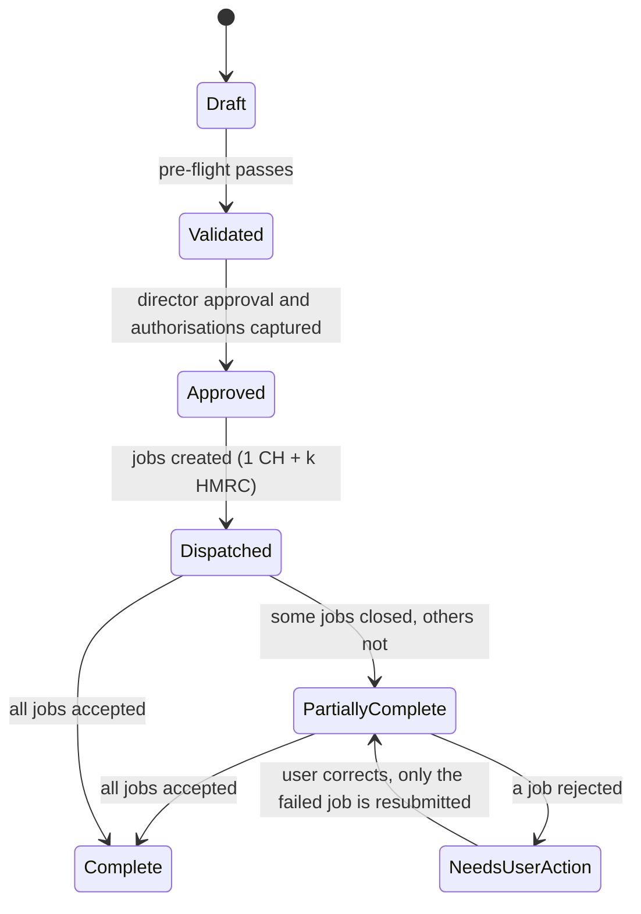
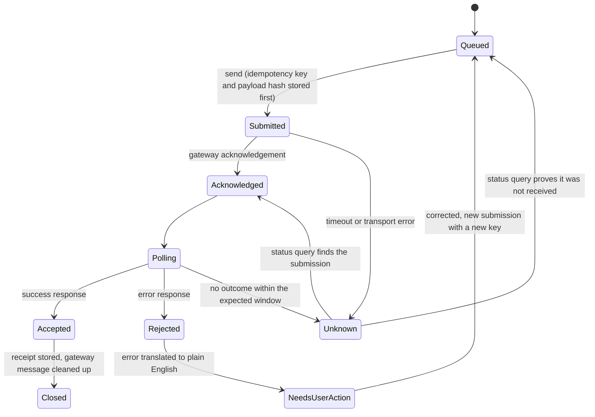

# TaxFlow UK — Product Requirements Document v4.1

**Product:** UK limited-company filing software: HMRC Corporation Tax (CT600) and Companies House micro-entity accounts
**Status:** Draft for review. Not approved for build until the gates in section 15 are passed.
**Evidence date:** 7 October 2026 (all "verified" facts were checked against the sources in Appendix C on this date)
**Supersedes:** v3.0 "Definitive Edition". See Appendix B for what changed and why.
**v4.1 (7 October 2026):** product owner decisions D-01 to D-04 recorded (section 16.2) and applied to sections 5, 6.6, 11, 12, 13 and 14.

### How to read this document

Every factual claim carries one of three tags, so you can see what rests on evidence and what does not.

- **[V]** Verified against a cited source on the evidence date.
- **[A]** Assumption or proposed target. Needs validation. Not a fact.
- **[VR-nn]** Open item in the Verification Register (section 16). Do not build against it until closed.

Rule for engineers: tax rates, thresholds, dates and statutory wording are **data with an effective date and a source**. They are never constants inside logic and never copied from this document into code without closing the linked VR item.

---

## 1. Executive summary

TaxFlow UK helps directors of micro-entity limited companies file their own Corporation Tax return and statutory accounts without an accountant. It does this by turning source figures into compliant iXBRL accounts and a CT600, explaining every tax number in plain English, and catching rejections before submission.

The opportunity is real but narrower and more contested than v3 claimed:

- HMRC's free joint filing service closed on 31 March 2026, so CT600 filing now needs commercial software **[V]**.
- Companies House software-only accounts filing is currently expected from April 2028, after two postponements **[V]**.
- A funded-by-SEO competitor, TinyTax, is already live at £20 (dormant) and £59 (solo) a year with trial balance import, manual entry, company lookup and automatic period splitting **[V]**.

**Strategy in one paragraph.** We do not win on a £10 price gap or on a checklist of tax features a competitor can copy. We win on three things: (1) the best path from messy source data to correct accounts for people who are not accountants, (2) calculations that are demonstrably right at the edges (extended periods, associated companies, cars, director's loans) and explained line by line, and (3) first-time acceptance, backed by pre-flight validation and plain-English rejection handling. Price is a supporting lever, not the thesis: Solo launches at a flat £49 with no VAT charged, because the company is not VAT-registered (section 12).

**What changed most since v3.** The tax parameters were refreshed (main pool WDA is now 14%, s455 is 35.75% for new loans), the calculation engine was rebuilt around period length and integer pence with an executable test suite (Appendix A), the market sizing claim was withdrawn pending real data, the delivery plan was made gate-driven instead of date-driven, and the document now contains requirements with acceptance criteria rather than marketing claims.

---

## 2. Problem, market and regulatory landscape

### 2.1 The problem

A director of a micro-entity needs to produce statutory accounts, a tax computation and a CT600, tag them in iXBRL, and submit to two different government gateways. The free route is gone. The alternatives are an accountant (v3 cited £800 to £1,500 a year, **[A]** unsourced) or learning a tool that assumes accounting vocabulary. Failure modes that matter: wrong tax, rejected filings with cryptic errors, late-filing penalties, and silent mistakes the director does not understand.

### 2.2 Market sizing (replaces v3's "4.87 million")

v3's claim that about 4.87 million companies "lost their free filing option" is withdrawn. The free service was open only to a narrow group: single trading companies, not in a group, with turnover up to £632,000 and small rental income **[V]**. Companies House's free web filing of micro-entity and dormant accounts stayed open after the HMRC closure **[V as of March 2026; recheck]**. Many companies also already use accountants.

Serviceable market is therefore:

```
SAM = (micro-entity companies with a CT600 obligation)
      × (share that self-file or are accountant-unserved)
      × (share reachable by our channels)
```

Inputs to source before any investment decision **[VR-16]**: number of micro-entity trading and dormant companies from Companies House and HMRC statistics, historic CATO volumes (request via FOI or find published figures), accountant-penetration data, and observed TinyTax scale (it self-reports 1,000+ companies filed **[V, self-reported]**). No market number appears in this PRD until those are in hand.

### 2.3 Regulatory register

| # | Item | Status on 7 Oct 2026 | Impact on product |
|---|------|----------------------|-------------------|
| R1 | HMRC/Companies House free joint filing service | Closed 31 March 2026; commercial software required from 1 April 2026 **[V]** | Demand driver. Amending or refiling old returns also needs software. |
| R2 | Companies House accounts reforms: software-only filing, P&L required for micro-entities and small companies, abridged accounts removed, strengthened audit-exemption eligibility statement, all parts filed together, fewer allowed shortenings of the accounting period | Now expected April 2028 per Companies House's updated transition plan **[V]**. Dates have moved at least twice, earlier plans said April 2027. | Build to the 2028 rules but treat the date as moving **[VR-13]**. |
| R3 | Identity verification for people filing at Companies House, and registration of agents as Authorised Corporate Service Providers (ACSPs) | No earlier than November 2027, with at least six months' notice **[V]** | Affects the accountant tier and the "we are outside AML" position (section 11). |
| R4 | Making Tax Digital for Income Tax thresholds: £50k (April 2026), £30k (April 2027), £20k (April 2028) | Carried from v3, **not re-verified** **[VR-21]** | Sole traders are out of scope for v1 (section 5). |
| R5 | Main pool writing-down allowance cut from 18% to 14% from 1 April 2026 for corporation tax; hybrid rate for periods straddling the date | **[V]** | Engine must be date-aware. |
| R6 | New 40% first-year allowance on new main-rate assets from 1 January 2026; cars (except zero-emission) excluded | **[V]** | Engine and interview must ask about asset type and date. |
| R7 | 100% FYA for new zero-emission cars and EV charge points extended to 31 March 2027 for corporation tax | **[V]** | Date-gated rule. Low-emission cars go to the main pool, high-emission cars to the special rate pool at 6% **[V]**. |
| R8 | Dividend upper rate 35.75% from 6 April 2026, so s455 charge is 35.75% for loans made on or after that date; earlier loans keep their earlier rate | **[V]** | s455 must be computed loan by loan by loan date. |
| R9 | Micro-entity qualification: at least two of turnover up to £1m, balance sheet total up to £500k, up to 10 employees | Stated on TinyTax's pricing page **[V, secondary]**. Another TinyTax page shows older figures, so confirm in legislation **[VR-14]**. | Eligibility gate (FR-03). |
| R10 | Corporation Tax rates 19% and 25%, limits £50k and £250k, marginal relief fraction 3/200 | Carried from v3 and consistent with the computation in Appendix A. **Recheck at each Budget.** | Held as versioned data. |

---

## 3. Competitive landscape

### 3.1 What is verified about TinyTax (the closest competitor)

| Attribute | Evidence |
|-----------|----------|
| Price | Dormant £20 a year, Solo £59 a year, Portfolio £99 per user per year **[V]**. A support page states "£59 + VAT", so the VAT-inclusive cost is about £70.80 **[V]**. Some marketing pages say micro-entity filing is free, so their pricing is inconsistent and may change. |
| Inputs | Trial balance import from CSV or Excel, Xero API connection, and direct entry of P&L and balance sheet figures **[V]**. |
| Company data | Company finder pulling details from Companies House **[V]**. A comparison page says it can fetch prior-year data from HMRC **[V, self-reported; mechanism unknown]**. |
| Period handling | Automatic period splitting for extended periods **[V]**. |
| Scope | Micro-entities (FRS 105) and small companies (FRS 102 section 1A) **[V]**. |
| Traction | "1,000+ companies filed", HMRC Recognised badge **[V, self-reported]**. |

### 3.2 Implications for v3 claims

- "Trial balance only" is wrong: TinyTax also supports direct entry. A "dual path" is not a differentiator on its own.
- "No prior-year handling" is contradicted by TinyTax's own claim.
- "Automatic period splitting" is already offered by TinyTax. Our edge is correctness and explanation, not existence.
- v3's "hidden upsell trap" and "over 70% don't know what a trial balance is" had no sources. **Removed.** To test with user research **[VR-22]**.
- v3's peer matrix for Taxpipe, WeFile, GoFile and TaxCalc was not verifiable here and is removed **[VR-11]**.

### 3.3 Where we can still win (hypotheses to test, not facts)

1. **Source-data on-ramp for non-accountants.** Bank CSV to a draft P&L, with prompts for the accruals a bank statement cannot show.
2. **Explained numbers.** Every figure on the CT600 traces to a plain-English line: what it is, which rule applied, which input drove it.
3. **First-time acceptance.** A published pre-flight rule catalogue and rejection translation that makes failure rare and recoverable.
4. **Edge-case correctness**, proved by a public test suite and tax-adviser review.
5. **Price transparency.** One flat price, no VAT line while unregistered, and a truthful side-by-side against competitors' all-in prices.

---

## 4. Product strategy

### 4.1 Personas

| ID | Persona | Job to be done | Success looks like |
|----|---------|----------------|--------------------|
| P1 | Contractor or freelancer director, no accounting knowledge | "File my company's year-end without paying an accountant or getting it wrong." | Files in one sitting, understands the tax figure, no HMRC rejection. |
| P2 | E-commerce seller director (stock, platform fees, VAT) | "Turn marketplace payouts and bank data into accounts." | Imports data, resolves stock and creditors with guidance, files. |
| P3 | Dormant or holding company director | "Meet the annual obligations with minimum effort." | Files in minutes. |
| P4 | Bookkeeper with 10 to 50 micro-entity clients (v1.1) | "File many small clients quickly under my own credentials." | Dashboard, bulk status, no per-client re-keying. |

### 4.2 Product principles

1. **Deterministic tax, assisted data.** AI may suggest categorisations and explain things. It never computes tax, never fills a statutory field unseen, and every suggestion needs user confirmation.
2. **Explain before you submit.** No user submits a number they cannot trace.
3. **Fail early, in plain English.** Block on certain errors, warn on likely ones, translate every gateway error.
4. **Honest scope.** If a company is out of scope, say so at the start.
5. **No unverifiable claims** in product copy. Time-to-file and acceptance rates are measured and published, not promised.

### 4.3 Non-goals for v1

- Tax advice, tax planning or optimisation. The product computes and explains what the filing contains, and flags choices, but does not recommend tax positions.
- Sole traders, partnerships, MTD for Income Tax, VAT, payroll.
- Groups, charities, community amateur sports clubs, companies that fail the micro-entity test (these are routed out in FR-03).
- Fully automatic filing without user review and director approval.

---

## 5. Scope and phasing

| Phase | Contents |
|-------|----------|
| **v1 (launch)** | Micro-entity trading and dormant companies. Company lookup. Guided interview, trial balance CSV import. FRS 105 balance sheet, P&L and notes in iXBRL. Period-aware CT computation, capital allowances, carry-forward losses, associated companies, s455 with CT600A. CT600 submission. Pre-flight validation and error translation. Billing. Receipts. |
| **v1.1** | Bank statement CSV importer with categorisation. Xero integration. Accountant (Portfolio) tier. Loss carry-back claims. Amendments. Deadline reminders. |
| **v2** | PDF bank statements, FRS 102 section 1A small companies, additional integrations, sole traders and MTD for Income Tax (if the strategy still supports it). |

Sole traders were in v3's mission statement but had no requirements. They are moved to v2 explicitly.

---

## 6. Functional requirements

Priority: **M** must, **S** should, **C** could. Each requirement has acceptance criteria (AC) written as testable statements.

### 6.1 Company setup and eligibility

**FR-01 Company lookup (M, v1).** Look up by name or number via the Companies House REST API and pre-fill name, number, registered office, officers, accounting reference date and filing history.
AC: Result shown with a "confirm this is your company" step. Lookup failure degrades to manual entry. No data is written until the user confirms.

**FR-02 Prior-period comparatives (M, v1).** Where the prior accounts were filed as iXBRL, extract comparatives. Otherwise require manual entry with a continuity check.
AC: Prior closing balances equal current opening balances or the user is shown the difference and must resolve it. Extraction accuracy is measured on a test corpus before release **[A]**.

**FR-03 Eligibility gate (M, v1).** Evaluate micro-entity status (two of three thresholds, plus statutory exclusions) **[VR-14]**, company type and activity scope.
AC: Ineligible users see the specific failed test, their options, and are not charged. The rule set is versioned data with an effective date.

**FR-04 Period planner (M, v1).** Determine the period of account and the CT accounting periods (first period, short period, extended period).
AC: For a period of account over 12 months the user sees a plan before any data entry: "1 set of accounts, 2 tax returns, with these dates and days." Day counts are inclusive. Reference case: 15 Mar 2025 to 31 Mar 2026 is 382 days, split 365 plus 17.

**FR-05 Authorisations (M, v1).** Capture the Companies House authentication code, HMRC Government Gateway credentials, and director approval of the accounts (name, date, statement).
AC: Credentials follow the handling rules in section 10.2. Accounts cannot be submitted without recorded director approval.

### 6.2 Data ingestion

**FR-10 Guided interview (M, v1).** An adaptive question flow, modular, covering turnover, cost of sales, expense categories, fixed assets and depreciation, stock, debtors, cash, creditors (under and over one year), director's loan, share capital, dividends, employees, losses brought forward, capital allowance pools brought forward, additions and disposals, associated companies and close-company status.
AC: Every question has a plain-English explanation and an example. Progress autosaves. Answers map to a defined data model. The number of questions is whatever the model needs. Median completion time is **measured**, not promised.

**FR-11 Trial balance import (M, v1).** CSV and Excel import with a mapping UI and saved mappings per source package.
AC: Unbalanced trial balances are rejected with the difference shown. Unmapped accounts block progress. Mapping decisions are reviewable.

**FR-12 Bank CSV importer (S, v1.1).** Parse major UK bank formats, categorise using rules plus model suggestions, always requiring user confirmation. Output is a draft cash-basis P&L plus explicit prompts for accruals, prepayments, debtors, creditors, stock and fixed assets.
AC: Parser accuracy is measured per bank format on a test corpus. No transaction is auto-categorised without being shown. PDF statements are v2.

**FR-13 Integrity checks (M, v1).** Balance sheet balances, P&L ties to retained earnings movement, comparatives continuous, sign and magnitude sanity checks.
AC: Blocking failures prevent progress to accounts generation.

### 6.3 Accounts generation

**FR-20 FRS 105 accounts (M, v1).** Generate balance sheet, **profit and loss account**, and required notes (including advances and credits to directors, employees, accounting policies) as iXBRL against the current FRC taxonomy entry points **[VR-02]**. v3's roadmap modelled only the balance sheet. A P&L is expected in accounts attached to the CT600 today **[VR-15]** and is required at Companies House from the 2028 reforms **[V]**.
AC: Output passes the Companies House test validator and Arelle against the current taxonomy. A rendered preview matches the tagged content.

**FR-21 Statutory statements (M, v1).** Audit-exemption and directors' statements are legal-reviewed templates, versioned by regime and effective date. **v3's wording must not be copied into code** **[VR-17]**: the 2028 reforms add a strengthened eligibility statement **[V]**, and v3's example tag prefix looked like legacy taxonomy naming.
AC: Wording is sourced from current Companies House and FRC guidance and signed off by a qualified reviewer. Changes are traceable by version.

**FR-22 Dormant path (M, v1).** Dormant company accounts with a minimal flow. Whether a nil CT600 is required depends on HMRC's position for that company **[VR-19]**.
AC: The flow states plainly whether a CT600 is required and why.

### 6.4 Tax computation (specification in section 7, executable form in Appendix A)

**FR-30 Period-aware computation (M, v1).** Corporation Tax per accounting period with limits scaled to period length and divided by (N+1).
AC: All Appendix A test cases pass in CI. Any change to rates or rules ships with new tests.

**FR-31 Capital allowances (M, v1).** Pools with brought-forward values, additions, disposals, balancing adjustments, AIA scaled to period length, FYAs, full expensing where applicable, hybrid WDA for straddling periods, small pool rule, cars routed by CO2 and acquisition date.
AC: Each asset class has worked examples agreed with a tax reviewer. Cars are never eligible for AIA or the new 40% FYA **[V]**. The 100% zero-emission FYA is date-gated to 31 March 2027 **[V]**.

**FR-32 Losses (M, v1; carry-back S, v1.1).** Brought-forward losses are never discarded. Current-period trading losses can be set against other profits of the period, and the remainder carries forward. Losses beyond what the engine models route to manual review **[VR-20]**.
AC: Test "b/f 20,000 plus current loss 5,000 gives 25,000 carried forward" passes.

**FR-33 Associated companies (M, v1).** Questionnaire that follows the statutory control tests, not a loose "do you own other companies" question **[VR-04]**. N is determined per accounting period.
AC: Questions and result are shown with a plain-English explanation of why the limits changed.

**FR-34 Loans to participators (M, v1).** Capture loans individually (date made, amount, repayments with explicit allocation to loans), compute s455 per loan at the rate for the loan date, confirm close-company status, generate CT600A from HMRC's schema, and flag the director-side benefit-in-kind position where relevant **[VR-06]**.
AC: Test "£10,000 made 31 Mar 2026 plus £10,000 made 6 Apr 2026 gives £3,375 plus £3,575" passes. Repayment allocation is never guessed.

**FR-35 CT600 generation (M, v1).** Build CT600 and supplementary pages from HMRC's published schema and RIM artefacts. **Box mappings come from the HMRC technical pack, not from memory** **[VR-03]**. Attach accounts and computations in iXBRL. For an extended period, one set of accounts is attached to each return, with computations for each period **[carried from v3, VR-15]**.
AC: Output validates against HMRC schemas and the Local Test Service **[V]**.

**FR-36 Explain-every-number (M, v1).** Each tax figure links to its inputs and rule.
AC: A user can click any tax line and see rule, rate, period days and inputs, in plain English.

### 6.5 Submission

**FR-40 Independent submission jobs (M, v1).** A filing consists of one Companies House accounts job and one HMRC CT600 job per accounting period. Each job has its own state machine and idempotency (section 8).
AC: Failure of one job never forces resubmission of another. Duplicate-submission test cases pass.

**FR-41 Pre-flight validation (M, v1).** A versioned catalogue of rules (section 9), blocking or warning.
AC: Each rule has an ID, source, severity, test fixture and plain-English message. The catalogue size is reported, not marketed.

**FR-42 Error translation (M, v1).** Every Companies House and HMRC error code encountered in test or production maps to a plain-English cause and next action.
AC: Coverage is tracked as a KPI. Unmapped codes alert the team and show a safe generic message with a support route.

**FR-43 Receipts and audit (M, v1).** Store acceptance receipts, correlation IDs, payload hashes, timestamps, user actions.
AC: A user can download their receipts. Retention follows section 10.

**FR-44 Reminders (S, v1.1).** Deadline reminders for accounts and CT filing and payment.
**FR-45 Amendments (S, v1.1).** CT600 amendment flow. Companies House corrections follow its own rules.

### 6.6 Account, billing and accountant tier

**FR-50 Accounts and billing (M, v1).** Email login with MFA, Stripe payments, and invoices that **do not charge or show VAT while the company is unregistered**. Invoicing must be able to switch to VAT-compliant invoices on a configured registration date without code changes (see 12.3).
**FR-51 Portfolio tier (S, v1.1).** Multi-client dashboard, roles, filing under the accountant's own credentials, readiness for ACSP requirements when they take effect **[V: no earlier than Nov 2027]**.

---

## 7. Tax and accounts specification

The authoritative executable form is Appendix A. This section states the rules and the decisions behind them.

### 7.1 Accounting period rules

- A period of account over 12 months produces **two or more CT accounting periods**: the first 12 months, then the remainder **[carried from v3; consistent with the engine in Appendix A, VR-15]**. v3 cited section 10 of CTA 2009 for the rule. **Confirm the correct section** before quoting it in product copy.
- Days are counted **inclusively**. v3's own example (15 Mar 2025 to 31 Mar 2026) was 382 days, not 381, and its split of 365 plus 17 days only adds up to 382.
- Companies House receives **one** set of accounts for the whole period of account. HMRC receives **one CT600 per accounting period**.
- Dates in a straddling period must be handled by a **rate table per financial year**, even though main rates are currently equal, so a future rate change does not need a code rewrite.

### 7.2 Profit apportionment in extended periods

- Accounting profit before tax adjustments is apportioned by days between periods. Capital allowances, balancing adjustments and other adjustments are **computed per period**, not apportioned from the total. v3 apportioned net profit and said nothing about allowances.
- AIA is scaled for periods shorter than 12 months **[VR-05]**.
- Apportioned pence must sum exactly to the total (Appendix A implements this and tests it).

### 7.3 Corporation Tax computation

1. Determine taxable total profits after losses (7.5).
2. Augmented profits = taxable total profits plus exempt distributions from non-group companies.
3. Limits: lower £50,000, upper £250,000, each **scaled by period days divided by the year basis** (365 or 366, **[VR-05]**) and **divided by (N+1)** associated companies.
4. If augmented profits are at or below the lower limit, tax is 19% of taxable total profits. At or above the upper limit, 25%.
5. In between: 25% of taxable total profits less marginal relief, where marginal relief = 3/200 × (upper limit − augmented profits) × (taxable total profits ÷ augmented profits).
6. Compute with exact arithmetic and round to pence once, at the output **[VR-12: confirm HMRC's rounding convention]**.

The v3 function had no period length, so a 17-day second return would have been taxed against full-year limits. In the Appendix A test, a £10,000 profit in a 17-day period gives £2,475.34 of tax. The v3 logic would have produced £1,900.

### 7.4 Capital allowances

| Item | Rule in this PRD |
|------|------------------|
| Main pool WDA | 18% for periods ending before 1 April 2026, 14% for periods starting on or after, and a **hybrid** rate for straddling periods, weighted by days in Appendix A **[V rule exists; method VR-08]** |
| Special rate pool | 6% **[V]** |
| New 40% FYA | New main-rate assets from 1 Jan 2026, not cars, not second-hand **[V]** |
| 100% FYA | New zero-emission cars and EV charge points, expenditure up to 31 March 2027 for corporation tax **[V]** |
| Cars | Not eligible for AIA. Not eligible for the 40% FYA. CO2 up to 50 g/km to main pool, above 50 g/km to special rate pool **[V for direction; threshold VR-08]** |
| Pools | Brought-forward value, additions, disposals, balancing allowance or charge, small pool |
| AIA | Limit scaled for short periods **[VR-05]** |

v3's car routing was structurally right, but the 18% figure and the unconditional 100% FYA were stale or incomplete.

### 7.5 Losses

- Current-period trading loss: set against other profits of the same period (claim), remainder carried forward.
- Brought-forward trading losses: set against total profits of later periods. **Never discarded**, including in loss-making years.
- v1 covers losses arising on or after 1 April 2017 only, and routes anything larger than the deductions allowance to manual review **[VR-20]**.
- Carry-back claims are v1.1. v3 advertised carry-back but its code did not implement it.

### 7.6 Associated companies

- Limits are divided by (N+1). N follows the statutory control and attribution rules, excludes companies inactive for the whole period, and is determined per accounting period **[VR-04]**.
- The product asks the statutory questions in plain English and records the answers.

### 7.7 Loans to participators (s455)

- Charge applies to close companies on loans outstanding at the due date, 9 months and 1 day after the period end **[V]**. Month-end convention for the due date is **[VR-07]**.
- Rate follows the dividend upper rate for the tax year **in which the loan was made**: 25% before 6 April 2016, 32.5% to 5 April 2022, 33.75% to 5 April 2026, 35.75% from 6 April 2026 **[V]**.
- It is a **temporary, refundable charge**, not a penalty **[V]**. v3's wording is corrected, and the product must say so.
- Repayment allocation matters because loans carry different rates, so the user chooses and the product shows the effect **[V that it matters; rules VR-06]**.
- Anti-avoidance rules for repay-and-redraw, and the exception for small loans to employees, must be confirmed and implemented **[VR-06]**.
- CT600A is generated from HMRC's schema. Box numbers are not hardcoded **[VR-03]**.

### 7.8 What the engine must refuse to do

Silently estimate. Anything outside modelled scope returns a **warning with a route to manual review** (Appendix A shows this for the losses restriction and for non-close companies with loans).

---

## 8. Submission architecture

### 8.1 Principles

1. **Two gateways, no shared fate.** Companies House and HMRC are separate jobs. v3 identified this correctly. v4 completes it.
2. **A filing is 1 + k jobs.** One Companies House accounts job, plus one CT600 job per accounting period. v3's diagram showed only two jobs, which contradicted its own extended-period design.
3. **Record intent before sending.** Persist the idempotency key and payload hash before the network call, so a crash cannot cause an untracked duplicate.
4. **Unknown is a state.** Timeouts do not mean failure.

### 8.2 Filing orchestrator



### 8.3 Per-job state machine (used for the Companies House job and each CT600 job)



### 8.4 Protocols **[VR-01, VR-02, VR-09]**

- **HMRC Corporation Tax:** GovTalk envelope to the Transaction Engine, acknowledgement with correlation ID, polling for the response, then message clean-up (the clean-up step is to be confirmed in the Transaction Engine documentation). Vendor ID is a **4-digit** identifier allocated by the Software Developer Support Team **[V]**. Test with the Local Test Service, then the External Test Service, then recognition scenarios issued by the team **[V]**. Registration is by contacting the team, **not** via the Developer Hub (v3 §9 contradicted its own §7). Test in Live is an end-user feature, not a vendor validation step **[V]**.
- **Companies House:** XML Gateway filing with the separate accounts supplement (version 5.7, 2025, was current in the sources reviewed) **[V]**. A vendor completes Companies House testing **before** applying for a presenter ID **[V]**, so this is a second approval track outside our control. Companies House plans to replace the XML platform with a REST API **[V]**, so submission sits behind an adapter interface.
- **IRmark:** SHA-1 over the canonicalised message body with the existing IRmark removed. v3's sample code had several risks: it inserted the element as the first child of Body rather than in the header, created it without the type attribute and namespace handling, and relied on an unmaintained canonicalisation package. **Treat v3's code as illustrative only. The specification is HMRC's IRmark document and its published test vectors** **[VR-01]**. A correct IRmark proves message integrity. It does not guarantee acceptance, and the "guarantees pass" claim is removed.

### 8.5 Technology (unchanged intent, stated as proposals **[A]**)

TypeScript on Node for the engine and gateway clients, Next.js frontend, PostgreSQL, a durable job queue (BullMQ was proposed in v3), AWS London region, infrastructure as code. The tax engine is a pure, dependency-light module so it can be tested exhaustively and reviewed by a tax professional.

---

## 9. Pre-flight validation and error translation

### 9.1 Rule catalogue (replaces the "40-point" claim)

The number 40 had no list behind it. The catalogue is built from sources, not from a target count:

| Source | Examples |
|--------|----------|
| HMRC CT online validation rules and schemas **[V exist]** | Required fields, cross-field consistency, supplementary pages, period dates |
| Companies House accounts validator and TIS **[V exist]** | iXBRL well-formedness, taxonomy entry point, required tags, period and entity details |
| Our integrity checks | Balance sheet balances, comparatives continuity, eligibility, period plan consistency |
| Our tax reasonableness warnings | Large swing in profit, unusual allowance claims, loan balances at year end |

Each rule: ID, source reference, severity (block or warn), fixture test, user-facing message. The published count is whatever the catalogue contains.

### 9.2 Error translation

Maintain a table from every gateway error code to cause, plain-English message, and next step. Seed it from test runs against the Local and External Test Services. Do **not** quote specific error numbers in marketing: v3 cited example codes without a source **[VR-23]**.

---

## 10. Non-functional requirements

All targets below are **proposals [A]** to be agreed and then measured.

### 10.1 Reliability and performance

| Area | Proposed target |
|------|-----------------|
| Availability | 99.9% monthly, with a higher internal objective on filing-deadline weeks |
| Recovery | RPO 15 minutes, RTO 4 hours |
| Interaction latency | p95 under 1 second for page interactions, pre-flight under 10 seconds |
| Submission durability | Zero lost submissions: every dispatch is recoverable from persisted state |
| Observability | Per-job tracing, alerting on stuck, unknown or rejected jobs, deadline-day dashboards |

### 10.2 Security and credential handling **[VR-09]**

v3 had no security section. Minimum requirements:

- **Government Gateway credentials and Companies House authentication codes are never stored in plain text and are never logged.** Default design: collected at submission time, held in memory for that submission only, discarded after. If product research shows this is too painful, any change requires an explicit decision, an HMRC conditions check and a threat-model update.
- Encryption in transit and at rest, field-level encryption for sensitive data, managed key rotation, least-privilege access, MFA for users and staff, immutable audit logs.
- Independent penetration test before launch (budgeted, see section 12).
- Secure development: dependency scanning, secrets scanning, SBOM, signed builds.
- Incident response plan with ICO notification procedure.

### 10.3 Privacy and data

UK GDPR: data protection impact assessment, ICO registration and fee, records of processing, retention schedule (receipts and audit data kept for a defined period, user data deletable on request subject to legal retention), processor agreements, UK data residency.

### 10.4 Accessibility and usability

WCAG 2.2 AA for all flows. Plain-English reading level target for explanations **[A]**. Usability test with non-accountants before launch.

### 10.5 AI guardrails

AI is allowed only for suggestions (categorisation, explanations drafts). It is not allowed to compute tax, alter statutory text, or auto-confirm any user-visible figure. All AI output carries a "suggested, please confirm" state, and model changes are regression-tested on a fixed corpus.

---

## 11. Legal, regulatory and liability

1. **Money Laundering Regulations position (replaces "100% outside MLR").** Supplying software to self-filers is plausibly outside the regulations, but v3 stated this as certain, and the claim that it "eliminates criminal exposure" is withdrawn. The position can change with features (anything that looks like tax advice or acting for a client) and with the accountant tier. **Obtain a written legal opinion before launch** **[VR-10]**.
2. **ACSP regime.** Filing at Companies House on behalf of a company is expected to require ACSP registration, which requires AML supervision, from no earlier than November 2027 **[V]**. Our accountant tier must support customers who are ACSPs, and our own role must be classified in the opinion above.
3. **Responsibility for figures.** Terms must make clear the user is responsible for the accuracy of source data. The product records each user confirmation. Define a remedy policy for software errors (for example, refunding fees and handling penalties caused by a proven product defect) with insurance advice **[A]**.
4. **Consumer and digital contract law.** Cancellation and refund policy, clear pricing including VAT, clear scope statements.
5. **Professional indemnity and cyber insurance.** Re-quote against the real risk. v3's £800 a year was unsupported **[VR-18]**.
6. **VAT on our own supplies.** Decision D-01: we are **not VAT-registered**, so no VAT is charged and none may appear on invoices or checkout. Registration becomes compulsory once taxable turnover passes the threshold, so section 12.3 defines monitoring and a pre-agreed response **[VR-18]**.

---

## 12. Pricing and unit economics

### 12.1 Pricing decisions (D-01, D-02) and what remains open

| Plan | v3 | v4.1 position |
|------|----|---------------|
| Solo (one trading company) | £49 a year | **Decided: £49 flat, no VAT charged (not VAT-registered).** Launch price anchored against £69, with a £59 test after social proof (12.4). |
| Dormant | £19 one-off | **Annual, not one-off**, because the obligation recurs each year. The price point is still open (**D-05**). |
| Accountant / Portfolio | £199 for 25, £499 unlimited | **Deferred to v1.1 (D-04).** No price is committed now. Competitor reference: £99 per user per year **[V]**. |

**Why the anchor needs care.** Competitor TinyTax shows £59 plus VAT, about £70.80 inclusive **[V]**. A "£69" reference is only usable in marketing if it matches a competitor's real, current price at the time of publication, and "launch price" wording is only usable if the price really does change later. Both are consumer-protection and advertising-standards points, so have the final copy checked **[VR-26]**. The safest form is a dated, sourced side-by-side ("£49 flat, no VAT" next to the competitor's current VAT-inclusive price) rather than a free-standing "£69".

"All-inclusive, no upsells" holds only if the scope list is exact. v1 scope is in section 5. Anything outside it is stated as out of scope up front, not sold later.

### 12.2 Unit economics, corrected

v3's arithmetic was internally consistent (£47.16 contribution on £49 is 96.2%) but its conclusion was not: **£1,652 ÷ £47.16 = 35.03, so breakeven is 36 customers, not 35**, and the inputs omitted material costs.

**Base case after D-01: the first three rows (£49 net of VAT).** The two VAT-inclusive rows are the contingency if registration is forced (12.3).

Model: contribution per filing = net revenue − payment fees − other variable cost (support, email, infrastructure). Breakeven = fixed costs ÷ contribution. Payment fees use **[A]** 1.5% + £0.20 per card payment **[VR-18]**. The model was computed in a script and the figures below are from that run.

| Scenario | Net revenue | Variable cost | Contribution | Fixed £1,652 (v3) | Fixed £6,000 | Fixed £12,000 |
|----------|-------------|---------------|--------------|-------------------|--------------|---------------|
| £49 net of VAT (not VAT-registered), light support | £49.00 | £1.94 | £47.06 | 36 | 128 | 255 |
| £49 net of VAT, £5 support allowance | £49.00 | £5.94 | £43.06 | 39 | 140 | 279 |
| £49 net of VAT, £10 support allowance | £49.00 | £10.94 | £38.06 | 44 | 158 | 316 |
| £49 including 20% VAT, £5 support allowance | £40.83 | £5.94 | £34.90 | 48 | 172 | 344 |
| £49 including 20% VAT, £10 support allowance | £40.83 | £10.94 | £29.90 | 56 | 201 | 402 |

Notes: the £6,000 and £12,000 fixed-cost columns are **illustrative placeholders [A]**, standing for a realistic budget that includes a penetration test, proper insurance and part-time support. Replace them with quotes. Breakeven here means covering fixed costs only. It ignores founder time and customer acquisition cost.

Customer acquisition and retention matter more than breakeven. With £34.90 contribution, a customer costing £30 to acquire pays back in about 0.86 filing years. With retention at 50%, 70% and 85%, three-year contribution per acquired customer is about £61, £76 and £90. An annual product with easy switching makes **retention the key unknown** **[VR-24]**.

### 12.3 VAT registration threshold: monitor and pre-decide

Being unregistered is a good launch position, not a permanent one. Registration is compulsory once taxable turnover in a rolling 12 months passes the registration threshold **[A: £90,000, confirm the current figure, VR-18]**. At £49 a filing, that is about **1,837 Solo filings in any rolling 12 months** (£90,000 ÷ £49, before counting any other taxable revenue).

Requirements:
- A finance dashboard shows rolling 12-month taxable turnover against the threshold, with alerts at 70% and 90%.
- Agree the response **now**: either absorb VAT (net revenue falls to £40.83 per £49 filing, shown in 12.2) or raise the price. This should be a recorded decision before the threshold is near, not a scramble at the deadline.
- While unregistered we cannot reclaim VAT on our own purchases, so costs in the model are gross.
- Invoicing and checkout must support the switch (FR-50).

### 12.4 Price test plan (D-02)

1. **Launch at £49** with the dated side-by-side comparison described in 12.1.
2. **After social proof exists** (reviews, a measured acceptance rate, and testimonials, with minimum thresholds agreed before launch **[A]**), run a controlled test of £59 on **new visitors only**, randomly split.
3. **Decide on evidence:** conversion, revenue per visitor, refund and support rates, and first-year renewal intent, with a pre-set sample size and run time to avoid reacting to noise.
4. **Do not change the price for customers mid-term.** Announce renewal pricing clearly in advance.
5. Note the VAT interaction: a higher price reaches the registration threshold with fewer customers (about 1,526 at £59 versus 1,837 at £49), so agree the 12.3 response before moving up.

---

## 13. Go-to-market and success metrics

### 13.1 Go-to-market

- Search content that is genuinely useful (guides on period splitting, director's loans, allowances), **not a fixed count** of pages. v3's "50 programmatic guides" is a deliverable, not a strategy.
- Accountant and bookkeeper partnerships and marketplace listings (v1.1).
- Public rule catalogue and test suite as trust assets.
- Transparent pricing with VAT shown.

### 13.2 Metrics (targets are proposals **[A]**, set after beta)

| Metric | Why it matters |
|--------|----------------|
| Activation: eligible users who start an interview | Demand and messaging |
| Completion rate to submission | Product quality |
| **First-time acceptance rate** by HMRC and Companies House | The core promise (initial target ≥ 98%) |
| Median time to file, measured | Replaces the "7 minutes" claim |
| Support contacts per filing | Cost and clarity |
| Unmapped gateway error rate | Error translation quality |
| CAC, payback, renewal rate | Business viability |
| Rolling 12-month taxable turnover vs VAT threshold | Triggers the 12.3 response |
| Price-test conversion and revenue per visitor | Evidence for the £59 decision |
| Tax-adviser review defect rate on a sampled set | Correctness |

---

## 14. Roadmap (gate-driven)

v3 planned eight weeks from nothing to production recognition. Engineering work on that scale may fit about 8 to 10 weeks, but recognition by HMRC, Companies House testing and presenter-ID approval are queues we do not control. **Plan for roughly 4 to 6 months to a recognition-gated launch [A], and treat dates as outputs of the gates, not inputs.**

**Phase 0: start immediately, in parallel**
- Contact the HMRC software developer support team for registration and a vendor ID. Apply for a Companies House XML test account.
- Commission the legal opinion (section 11) and engage a tax reviewer.
- Close the high-priority VR items (section 16).
- Set up the HMRC Local Test Service in the dev environment **[V available]**.

**Phase 1: engine and accounts (about 8 to 10 weeks)**
- Reference tax engine (Appendix A) hardened with reviewer-approved test cases. Capital allowances engine. Period planner.
- FRS 105 accounts, P&L, notes in iXBRL, validated with Arelle and the Companies House validator.
- Interview and trial balance import. Pre-flight catalogue v1.

**Phase 2: gateways and approval (about 8 to 12 weeks, overlapping)**
- GovTalk client, IRmark, job state machines, receipts.
- HMRC External Test Service scenarios, then recognition submission. Companies House testing, then presenter ID.
- Security hardening, penetration test, privacy documentation.

**Phase 3: private beta**
- Real users with live data, subject to HMRC guidance on pre-recognition use **[VR-25]**. Measure acceptance, completion, support load.

**Phase 4: public launch**
- Launch after gates G1 to G4. Then v1.1 (bank CSV importer and the accountant tier, both deferred by decision D-03 and D-04, plus amendments and reminders).

**Gates**

| Gate | Criteria |
|------|----------|
| G1 | Legal opinion received. Vendor ID and Companies House test account obtained. High-priority VR items closed. |
| G2 | All reviewer-approved tax cases pass. HMRC recognition scenarios pass. Companies House testing complete. |
| G3 | Beta first-time acceptance at or above target. No unresolved correctness defects. |
| G4 | Clean penetration test. DPIA complete. Support and incident processes tested. |

---

## 15. Risk register

| ID | Risk | Likelihood | Impact | Mitigation |
|----|------|-----------|--------|-----------|
| K1 | Tax rules change again (allowances, rates, s455, deadlines) | High | High | Versioned rule data, effective dates, per-Budget review, test-first changes |
| K2 | Incorrect tax in an edge case harms a customer | Medium | Very high | Executable spec, reviewer sign-off, explain-every-number, manual-review routing, remedy policy |
| K3 | HMRC or Companies House approval slower than planned | High | High | Start Phase 0 now, gate-based planning, cash runway for 6 months |
| K4 | Competitor matches features and undercuts price | High | Medium | Compete on ingestion, explanation and acceptance, not price |
| K5 | Companies House dates or processes shift (2027 to 2028 already happened) | High | Medium | Isolated adapters, avoid date-dependent marketing claims |
| K6 | Credential or data breach | Low | Very high | Section 10.2, pen test, minimal storage, incident plan |
| K7 | Regulatory classification (AML or tax adviser) turns out wrong | Medium | High | Legal opinion before launch, feature boundaries, accountant-tier review |
| K8 | Data ingestion quality is poor, so users abandon or file wrong numbers | High | High | Guided prompts for accruals, integrity checks, measure completion and defect rates |
| K9 | Economics fail on CAC and retention | Medium | High | Early CAC and retention experiments, honest breakeven model |
| K10 | Gateway outage on deadline days | Medium | High | Queueing, status communication, deadline-week operations plan |

---

## 16. Verification register and decisions

### 16.1 Verification register

Close each item with the stated method before building against it. Priority: **H** blocks build or launch, **M** needed before beta, **L** hygiene.

| ID | Pri | Item | Method |
|----|-----|------|--------|
| VR-01 | H | IRmark specification (element location, type attribute, namespaces, canonicalisation scope), test vectors | HMRC IRmark support document and samples, Local Test Service |
| VR-02 | H | iXBRL tags and prefixes for statutory statements, current FRC taxonomy entry points, current Companies House accounts TIS version (v3 said 5.9, 5.7 seen) | Companies House TIS and test validator, FRC taxonomy files, Arelle |
| VR-03 | H | CT600 and CT600A box mappings | HMRC CT600 technical pack and RIM artefacts. No hand-copied box numbers. |
| VR-04 | H | Associated company definition: control, attribution, inactive exclusion, per-period count | Legislation text and HMRC manual, tax reviewer |
| VR-05 | H | Short-period scaling convention (days over 365, 366 or months over 12) for limits and AIA | HMRC guidance, tax reviewer |
| VR-06 | H | s455: repayment matching and allocation, repay-and-redraw rules, small employee loan exception, director benefit-in-kind | Legislation and HMRC manual, tax reviewer |
| VR-07 | M | Payment due date for month-end year ends (for example 30 June) | HMRC payment guidance |
| VR-08 | H | Hybrid WDA method, full expensing interaction, car CO2 thresholds, expenditure-date rules for FYAs | HMRC guidance, tax reviewer |
| VR-09 | H | HMRC and Companies House conditions on handling user credentials | HMRC developer support team, Companies House |
| VR-10 | H | AML, tax-adviser and ACSP classification | Written legal opinion |
| VR-11 | M | Competitor facts for Taxpipe, WeFile, GoFile, TaxCalc | Primary-source pricing and feature review |
| VR-12 | M | CT600 rounding convention | HMRC technical pack, test scenarios |
| VR-13 | M | Companies House reform dates and ID verification timeline (moved at least twice) | Monitor Companies House transition plan quarterly |
| VR-14 | H | Micro-entity thresholds and exclusions | Companies Act 2006 as amended, Companies House guidance |
| VR-15 | M | HMRC expectation of a P&L in attached accounts, attachment rules for extended periods, computation taxonomy | HMRC technical pack, ETS scenarios |
| VR-16 | H | Market sizing inputs | Companies House and HMRC statistics, FOI, interviews |
| VR-17 | H | Statutory statement wording and tagging | Current Companies House and FRC guidance, qualified reviewer |
| VR-18 | M | Payment fee schedule, current VAT registration threshold and rules for an unregistered business, insurance quotes | Stripe pricing, HMRC VAT guidance, insurance broker |
| VR-19 | M | Dormant companies: when a nil CT600 is required | HMRC guidance |
| VR-20 | M | Loss restrictions and pre-April-2017 losses | Legislation, tax reviewer |
| VR-21 | L | MTD for Income Tax thresholds (v3 figures) | HMRC GOV.UK pages |
| VR-22 | M | Do non-accountant directors really struggle with trial balances? How much? | 10 to 15 user interviews, usability tests |
| VR-23 | L | Real gateway error codes and meanings | ETS and LTS runs, HMRC and Companies House error lists |
| VR-24 | M | Retention and switching behaviour in annual filing software | Competitor review, early-cohort data |
| VR-25 | M | What live use is allowed before recognition | HMRC developer support team |
| VR-26 | M | Advertising and consumer-law check on the £69 anchor, "launch price" wording and comparison claims | ASA and CMA guidance, legal review of final copy |

### 16.2 Decision log and remaining open decisions

| ID | Decision | Date | Consequence |
|----|----------|------|-------------|
| D-01 | **Solo is £49 flat. No VAT charged: the company is not VAT-registered.** | 7 Oct 2026 | Net revenue £49.00 per filing. Invoices show no VAT. Registration threshold monitoring is mandatory (12.3). |
| D-02 | **Launch at £49, anchored against £69, then test £59 after social proof.** | 7 Oct 2026 | Comparative claims need review and must stay truthful (12.1, VR-26). Test plan in 12.4. |
| D-03 | **Bank CSV import deferred to v1.1.** | 7 Oct 2026 | v1 ingestion is interview plus trial balance import. This removes the hardest accuracy risk from launch (FR-12). |
| D-04 | **Accountant / Portfolio tier deferred to v1.1.** | 7 Oct 2026 | No multi-client features, no accountant pricing at launch. ACSP exposure from R3 is postponed (FR-51). |

**Remaining open decisions**

- **D-05:** Annual price for the dormant plan.
- **D-06:** Set the minimum "social proof" thresholds that unlock the £59 test (for example number of reviews and a measured acceptance rate).
- **D-07:** Agree the response to hitting the VAT threshold: absorb or reprice (12.3).

---

## Appendix A: Reference tax engine (executable specification)

This replaces v3's `computeCorporationTax`. It was written, then tested, as part of this revision. It differs from v3 in these ways:

- All money is **integer pence**.
- Limits scale with **period length** and divide by (N+1).
- **Brought-forward losses are never discarded**, and current losses can be set against other profits.
- s455 is computed **loan by loan at the rate for the loan date**, close companies only.
- Extended periods are split with **inclusive day counts**, and apportionment preserves every penny.
- Rates are **data tables**, not constants.
- Anything not modelled returns a **warning**.

It is a specification. Production code should be reviewed by a tax professional against the open VR items before use.

```typescript
// TaxFlow UK - reference corporation tax engine (executable specification).
// All money is integer pence. Dates are ISO yyyy-mm-dd, inclusive at both ends.
// Rates and thresholds are DATA (see RATE_TABLES), never constants buried in logic.

export type Pence = number;
export interface DateRange { start: string; end: string }

// ---------- date helpers (UTC, no local-time surprises) ----------
const MS_DAY = 86_400_000;
const parse = (iso: string): Date => {
  const [y, m, d] = iso.split('-').map(Number);
  return new Date(Date.UTC(y, m - 1, d));
};
const fmt = (dt: Date): string => dt.toISOString().slice(0, 10);
const addDays = (iso: string, n: number): string => fmt(new Date(parse(iso).getTime() + n * MS_DAY));

/** Inclusive day count: 2025-03-15 .. 2026-03-31 is 382, not 381. */
export function daysInclusive(start: string, end: string): number {
  return Math.round((parse(end).getTime() - parse(start).getTime()) / MS_DAY) + 1;
}

/** Corresponding-date month addition; clamps to month end when the day does not exist. */
export function addMonths(iso: string, months: number): string {
  const d = parse(iso);
  const y = d.getUTCFullYear();
  const m = d.getUTCMonth() + months;
  const day = d.getUTCDate();
  const lastOfTarget = new Date(Date.UTC(y, m + 1, 0)).getUTCDate();
  return fmt(new Date(Date.UTC(y, m, Math.min(day, lastOfTarget))));
}

// ---------- accounting period splitting ----------
/** A period of account longer than 12 months becomes a 12-month CT period plus the remainder. */
export function splitIntoAccountingPeriods(start: string, end: string): DateRange[] {
  const out: DateRange[] = [];
  let cursor = start;
  while (cursor <= end) {
    const twelveMonthEnd = addDays(addMonths(cursor, 12), -1);
    const apEnd = twelveMonthEnd < end ? twelveMonthEnd : end;
    out.push({ start: cursor, end: apEnd });
    cursor = addDays(apEnd, 1);
  }
  return out;
}

/** Statutory payment date: 9 months and 1 day after period end (verify month-end convention, PRD VR-07). */
export const ctPaymentDueDate = (apEnd: string): string => addDays(addMonths(apEnd, 9), 1);

// ---------- versioned rate data ----------
export interface RateTable {
  smallProfitsLimitPence: Pence; // full-year, before associated-company division
  upperLimitPence: Pence;
  smallRateNum: number; smallRateDen: number; // 19/100
  mainRateNum: number; mainRateDen: number;   // 25/100
  marginalFractionNum: number; marginalFractionDen: number; // 3/200
}
export const RATES_FY2023_ONWARDS: RateTable = {
  smallProfitsLimitPence: 50_000_00, upperLimitPence: 250_000_00,
  smallRateNum: 19, smallRateDen: 100, mainRateNum: 25, mainRateDen: 100,
  marginalFractionNum: 3, marginalFractionDen: 200,
};

/** s455 rate follows the dividend upper rate for the tax year in which the LOAN WAS MADE. */
export const S455_RATE_BANDS: { from: string; ratePct: number }[] = [
  { from: '0000-01-01', ratePct: 25 },
  { from: '2016-04-06', ratePct: 32.5 },
  { from: '2022-04-06', ratePct: 33.75 },
  { from: '2026-04-06', ratePct: 35.75 },
];
export function s455RatePct(loanMadeOn: string): number {
  let rate = S455_RATE_BANDS[0].ratePct;
  for (const b of S455_RATE_BANDS) if (loanMadeOn >= b.from) rate = b.ratePct;
  return rate;
}

// ---------- capital allowance parameters that depend on the period ----------
export const MAIN_WDA_CHANGE_DATE = '2026-04-01'; // 18% -> 14% for corporation tax
/** Hybrid main-pool WDA for a period straddling the change date, weighted by days (verify, PRD VR-08). */
export function mainPoolWdaRatePct(p: DateRange): number {
  const total = daysInclusive(p.start, p.end);
  if (p.end < MAIN_WDA_CHANGE_DATE) return 18;
  if (p.start >= MAIN_WDA_CHANGE_DATE) return 14;
  const before = daysInclusive(p.start, addDays(MAIN_WDA_CHANGE_DATE, -1));
  return (before * 18 + (total - before) * 14) / total;
}

// ---------- corporation tax ----------
export interface DirectorLoan { id: string; madeOn: string; outstandingAtDueDatePence: Pence }

export interface PeriodInput {
  period: DateRange;
  daysInYearBasis: 365 | 366;            // limit scaling convention, PRD VR-05
  associatedCompanies: number;           // N, statutory count, not "other companies you own"
  tradingProfitAfterAllowancesPence: Pence; // may be negative (a loss)
  nonTradingIncomePence: Pence;          // e.g. bank interest; must be EXCLUDED from the trading figure
  exemptDistributionsPence: Pence;       // non-group dividends, for augmented profits only
  tradingLossesBroughtForwardPence: Pence; // post-1 April 2017 losses only in v1
  setOffCurrentLossAgainstOtherProfits: boolean;
  closeCompany: boolean;
  directorLoans: DirectorLoan[];
}

export interface PeriodResult {
  days: number;
  lowerLimitPence: number; upperLimitPence: number;
  totalTaxableProfitsPence: Pence;
  augmentedProfitsPence: Pence;
  ctBeforeReliefPence: Pence; marginalReliefPence: Pence; corporationTaxPence: Pence;
  s455TaxPence: Pence; s455Lines: { loanId: string; ratePct: number; taxPence: Pence }[];
  lossesCarriedForwardPence: Pence;
  warnings: string[];
}

const roundP = (x: number): Pence => Math.round(x);

export function computePeriod(i: PeriodInput, rates: RateTable = RATES_FY2023_ONWARDS): PeriodResult {
  const warnings: string[] = [];
  for (const v of [i.tradingProfitAfterAllowancesPence, i.nonTradingIncomePence, i.exemptDistributionsPence,
    i.tradingLossesBroughtForwardPence]) {
    if (!Number.isSafeInteger(v)) throw new Error('Money must be integer pence');
  }
  if (i.associatedCompanies < 0 || !Number.isInteger(i.associatedCompanies)) throw new Error('Invalid N');

  const days = daysInclusive(i.period.start, i.period.end);
  if (days > 366) throw new Error('Accounting period exceeds 12 months: split it first');

  // 1. Losses. Brought-forward losses are never discarded.
  let trading = i.tradingProfitAfterAllowancesPence;
  let lossCF = i.tradingLossesBroughtForwardPence;
  let other = i.nonTradingIncomePence;
  if (trading < 0) {
    const currentLoss = -trading;
    if (i.setOffCurrentLossAgainstOtherProfits && other > 0) {
      const used = Math.min(currentLoss, other);
      other -= used;
      lossCF += currentLoss - used;
    } else {
      lossCF += currentLoss;
    }
    trading = 0;
  }
  let ttp = trading + other;
  // Only brought-forward losses are set against this period's profits; the current-period
  // unrelieved loss is carried forward as well and is never consumed in the same period.
  const usedBroughtForward = Math.min(i.tradingLossesBroughtForwardPence, ttp);
  ttp -= usedBroughtForward;
  lossCF -= usedBroughtForward;
  if (lossCF > 5_000_000_00) warnings.push('Losses exceed the deductions allowance: restriction not modelled, route to manual review');

  const augmented = ttp + i.exemptDistributionsPence;

  // 2. Thresholds: scaled for period length, then divided by (N + 1).
  const scale = Math.min(1, days / i.daysInYearBasis);
  const divisor = i.associatedCompanies + 1;
  const L = (rates.smallProfitsLimitPence * scale) / divisor;
  const U = (rates.upperLimitPence * scale) / divisor;

  // 3. Tax with marginal relief. Computed in exact floats then rounded once.
  let ctBefore = 0, mr = 0, ct = 0;
  if (ttp > 0) {
    if (augmented <= L) {
      ct = roundP((ttp * rates.smallRateNum) / rates.smallRateDen);
      ctBefore = ct;
    } else if (augmented >= U) {
      ct = roundP((ttp * rates.mainRateNum) / rates.mainRateDen);
      ctBefore = ct;
    } else {
      ctBefore = roundP((ttp * rates.mainRateNum) / rates.mainRateDen);
      mr = roundP((rates.marginalFractionNum * (U - augmented) * ttp) / (rates.marginalFractionDen * augmented));
      ct = ctBefore - mr;
    }
  }

  // 4. s455, loan by loan, at the rate for the date each loan was made.
  const s455Lines = [];
  let s455 = 0;
  if (i.directorLoans.length && !i.closeCompany) {
    warnings.push('s455 applies to close companies only: no charge computed');
  } else {
    for (const l of i.directorLoans) {
      const rate = s455RatePct(l.madeOn);
      const tax = roundP((l.outstandingAtDueDatePence * rate) / 100);
      s455Lines.push({ loanId: l.id, ratePct: rate, taxPence: tax });
      s455 += tax;
    }
  }

  return {
    days, lowerLimitPence: L, upperLimitPence: U, totalTaxableProfitsPence: ttp,
    augmentedProfitsPence: augmented, ctBeforeReliefPence: ctBefore, marginalReliefPence: mr,
    corporationTaxPence: ct, s455TaxPence: s455, s455Lines, lossesCarriedForwardPence: lossCF, warnings,
  };
}

// ---------- extended period apportionment ----------
/** Time-apportion a profit figure across the split periods (accounting profit BEFORE tax adjustments). */
export function apportionByDays(totalPence: Pence, periods: DateRange[]): Pence[] {
  const days = periods.map(p => daysInclusive(p.start, p.end));
  const total = days.reduce((a, b) => a + b, 0);
  const parts = days.map(d => Math.floor((totalPence * d) / total));
  parts[parts.length - 1] += totalPence - parts.reduce((a, b) => a + b, 0); // remainder pence to last period
  return parts;
}
```

### Test suite result

The full suite (`ct_engine.test.ts`) was run with Node.js 22 on the evidence date:

```
ok  inclusive day count is 382 for the PRD example
ok  extended period splits into 365 + 17 days
ok  leap-year split: 12 months from 1 Mar 2023 ends 29 Feb 2024
ok  12-month period is not split
ok  18-month period splits at 12 months
ok  payment due dates (unambiguous cases)
ok  small profits rate: 30,000 -> 5,700
ok  marginal relief: 100,000 -> 22,750
ok  main rate: 300,000 -> 75,000
ok  one associated company halves limits: 60,000 -> 14,025
ok  boundaries: A=L is 19%, A=U is 25%
ok  exempt distributions raise augmented profits: 100k + 50k FII -> 24,000
ok  short 17-day period scales the limits (original spec would give 1,900)
ok  brought-forward losses survive a loss-making year
ok  current loss is set against interest first
ok  b/f losses reduce total profits
ok  s455 rate bands follow the loan date
ok  s455 is computed loan by loan: 3,375 + 3,575
ok  s455 not charged on a non-close company
ok  hybrid WDA rate
ok  apportionment conserves every penny
ok  rejects floats and over-length periods

22 tests passed
```

Key worked cases, for human review:

| Case | Inputs | Expected | Result |
|------|--------|----------|--------|
| Small profits | £30,000, N=0, 12 months | £5,700 | pass |
| Marginal relief | £100,000, N=0 | £22,750 (relief £2,250) | pass |
| Main rate | £300,000 | £75,000 | pass |
| One associated company | £60,000, N=1 | £14,025 | pass |
| Distributions | £100,000 profit + £50,000 exempt dividends | £24,000 | pass |
| 17-day period | £10,000, N=0 | £2,475.34 (relief £24.66) | pass |
| Losses | b/f £20,000, current loss £5,000 | £25,000 carried forward | pass |
| s455 by loan date | £10,000 on 31 Mar 2026 plus £10,000 on 6 Apr 2026 | £3,375 plus £3,575 | pass |
| Extended period | 15 Mar 2025 to 31 Mar 2026 | 382 days, split 365 plus 17 | pass |

---

## Appendix B: v3 findings and v4 resolution

| # | v3 finding | v4 resolution |
|---|-----------|---------------|
| 1 | "Production Ready" label and no requirements, personas or acceptance criteria | Status corrected. Sections 4 and 6 add personas, requirements and ACs. Section 13 adds metrics. |
| 2 | Main pool WDA hardcoded at 18% | 14% from 1 April 2026, hybrid for straddling periods, versioned data (7.4, R5) |
| 3 | s455 hardcoded at 33.75% and described as a "penalty" | 35.75% for loans from 6 April 2026, per-loan computation, described as temporary and refundable (7.7) |
| 4 | Zero-emission FYA unconditional | Date-gated to 31 March 2027, 40% FYA exclusions noted (7.4) |
| 5 | Companies House date (April 2028) | Confirmed as correct for the current plan, flagged as moving (R2) |
| 6 | Missing identity verification and ACSP regime | Added with timing and impact (R3, section 11) |
| 7 | "4.87 million companies lost free filing" | Withdrawn, replaced with a sizing method (2.2) |
| 8 | Competitor claims unsourced or contradicted | Rebuilt from verified TinyTax facts, others removed pending research (3) |
| 9 | No period length in the tax function | Period-aware thresholds (7.3, Appendix A) |
| 10 | Day count 381 vs 382 | Inclusive counting, tested (7.1, Appendix A) |
| 11 | Allowances apportioned from net profit | Computed per period (7.2) |
| 12 | Brought-forward losses dropped in loss years | Fixed and tested (7.5) |
| 13 | Loss relief limited, carry-back advertised but absent | Scoped honestly: carry-back is v1.1 (7.5, FR-32) |
| 14 | Possible double counting of interest | Interest is a separate input, excluded from the trading figure (Appendix A) |
| 15 | Floating-point money | Integer pence (Appendix A) |
| 16 | Associated-company question too loose | Statutory questions, per period, inactive exclusion (7.6, VR-04) |
| 17 | IRmark code risks and "guarantees pass" claim | Treated as illustrative, spec-first approach, claim removed (8.4, VR-01) |
| 18 | Statutory wording and tag prefix doubtful | Not reused, template and review process defined (FR-21, VR-17) |
| 19 | Vendor ID, Developer Hub, Test in Live errors; Companies House testing missing | Corrected and added (8.4, section 14) |
| 20 | Architecture diagram showed 2 jobs, lacked unknown states | 1+k jobs, per-job state machine with Unknown (section 8) |
| 21 | Roadmap: P&L missing, 8-week launch | P&L in FR-20, gate-driven plan, 4 to 6 month estimate (section 14) |
| 22 | Scope inconsistency (sole traders, MTD) | Explicit v2 (section 5) |
| 23 | No eligibility gate, no director approval, no notes | FR-03, FR-05, FR-20, FR-22 |
| 24 | Ingestion under-specified, "7 minutes", "40-point" claims | FR-10 to FR-13, measured metrics, rule catalogue (9) |
| 25 | Unit economics: 35 vs 36, missing VAT, fees, pen test, CAC | Corrected model and scenarios (12.2) |
| 26 | Dormant pricing as one-off | Annual (12.1) |
| 27 | "100% outside MLR" overclaim | Legal opinion required (11, VR-10) |
| 28 | No security, privacy, liability sections | Section 10 and 11 |

| 29 | v4.1: pricing and scope decisions D-01 to D-04 | Applied to 3.3, 6.6, 11, 12, 13, 14 and 16.2 |

**Not closed by this document** (because evidence is not available here): VR-01 through VR-26. Each is assigned a method in section 16.

---

## Appendix C: Sources consulted on 7 October 2026

- DWF, *Further delays to compulsory identity verification and changes to filing of accounts* (19 Aug 2026): https://dwfgroup.com/en/news-and-insights/insights/2026/8/delays-to-implementation-of-compulsory-identity-verification
- GOV.UK, *Capital allowances: new first-year allowance and reducing main rate writing-down allowances*: https://www.gov.uk/government/publications/new-first-year-allowance-and-main-rate-of-writing-down-allowances/capital-allowances-new-first-year-allowance-and-reducing-main-rate-writing-down-allowances
- Deloitte Taxscape, *Capital allowances: WDA rate reduction and new FYA*: https://taxscape.deloitte.com/measures-autumn-budget-2025/capital-allowances--writing-down-allowances-rate-reduction-and-new-first-year-allowance.aspx
- GOV.UK, *Income Tax: changes to tax rates for property, savings and dividend income*: https://www.gov.uk/government/publications/income-tax-changes-to-tax-rates-for-property-savings-and-dividend-income
- Section 455 rate commentary: https://www.accountingfirms.co.uk/blog/section-455-an-unannounced-tax-rise/ and https://www.alto-accounting.com/insights/section-455-directors-loan-rate-2026-27
- GOV.UK, *Filing company accounts and tax returns if you previously used the HMRC online service*: https://www.gov.uk/corporation-tax-use-hmrcs-free-filing-software
- AccountingWeb, closure of the HMRC online filing service (eligibility limits): https://www.accountingweb.co.uk/node/222682
- Xero, CATO closure guidance (Companies House web filing status): https://blog.xero.com/small-business-resources/cato-closure-changes/
- TinyTax: https://tinytax.co.uk/pricing, https://tinytax.co.uk/guides/tinytax-for-accountants, https://tinytax.co.uk/compare/tinytax-vs-easy-digital-filing, https://tinytax.co.uk/support/which-company-types-are-supported
- AccountingWeb, TinyTax launch coverage: https://www.accountingweb.co.uk/node/227661
- GOV.UK, *Basic guide for XML software developers*: https://www.gov.uk/guidance/basic-guide-for-xml-software-developers
- HMRC, *Corporation Tax online: how to use the test service* (v1.4a): https://assets.publishing.service.gov.uk/media/637e3914d3bf7f153dd5632f/How_to_use_the_test_service-v1.4a.odt
- Companies House, *Important information for software developers*: https://www.gov.uk/government/publications/technical-interface-specifications-for-companies-house-software/important-information-for-software-developers-read-first
- Companies House, *TIS for accounts v5.7 (2025)*: https://assets.publishing.service.gov.uk/media/67d82c09d29c27fe69fe930f/Companies_House_TIS_Accounts_Separate__Final__v5.7_2025.odt
- Companies House, *TIS v5.3* (notes the plan to replace the XML platform with a REST API): https://assets.publishing.service.gov.uk/media/66618d1d2aec9626ea8805c1/Companies_House_TIS_v5.3.odt

Note: earlier articles (for example from 2025) give 1 April 2027 as the Companies House software-only date. They are superseded by the August 2026 update above.
