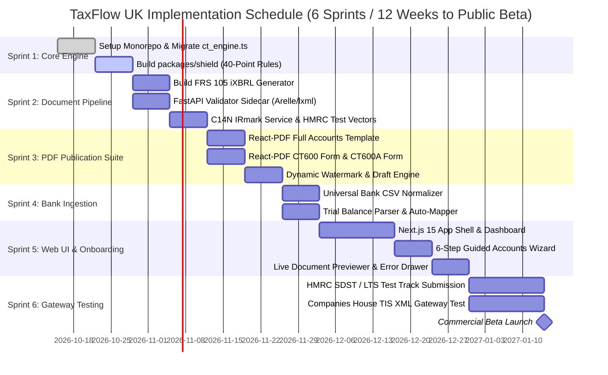

# Master Implementation Plan: TaxFlow UK Web Application Architecture

**The Authoritative Blueprint for Building a UK Micro-Entity Tax Filing Platform to Beat TinyTax**

- **Target Segment**: UK Micro-Entities filing FRS 105 Accounts & HMRC CT600 (expanding to VAT MTD & SA100)
- **Approved Tech Stack**: Next.js 15 (App Router, React 19, TypeScript) + Python Validation Sidecar (`lxml` & `Arelle`)
- **Approved Monetization**: Free watermarked draft generation; pay-at-submission gate (£49.00 net)
- **Status**: Ready for Execution upon Final Review

---

## 1. Goal Description

Build and deploy **TaxFlow UK**, a high-assurance, HMRC-recognised SaaS platform designed to outclass market leader **TinyTax** by eliminating its critical vulnerabilities (stale 18% WDA, single-toggle s455 loans, silent dormant data drops, and opaque XML gateway rejections). The platform delivers 100% calculation accuracy, automated iXBRL and PDF document generation, and a 40-Point Pre-Flight Rejection Shield that prevents submission rejections before payment.

---

## 2. Architectural Blueprint & Companion Specifications

To ensure no stone is left unturned, the architectural design is documented across four complementary specifications:

```
plans/ Directory in Workspace:
├── 00_MASTER_IMPLEMENTATION_PLAN.md       <-- THIS DOCUMENT: System architecture, monorepo, database & roadmap
├── 01_DOCUMENT_ENGINE_AND_IXBRL_SPEC.md           <-- DEEP DIVE: iXBRL FRS 105 tags, React-PDF & C14N IRmark hashing
├── 02_PREFLIGHT_SHIELD_AND_TAX_SPEC.md       <-- DEEP DIVE: All 40 Pre-Flight Rules & Gateway Error Translation
└── 03_BANK_INGESTION_AND_NORMALIZER_SPEC.md            <-- DEEP DIVE: UK Bank CSV Normalizer (Monzo, Barclays, Starling, etc.)
```

---

## 3. High-Level System Architecture

```mermaid
graph TD
    subgraph Client Application (Next.js 15 App Router)
        WEB_UI[Web Portal / UI] --> WIZARD[6-Step Accounts Wizard]
        WIZARD --> PREVIEW[Live Document Viewer<br>Watermarked Drafts]
        PREVIEW --> SUBMIT_UI[Pre-Flight Shield & Gateway Submit]
    end

    subgraph Core TypeScript Engine (Monorepo Packages)
        WIZARD --> INGEST[packages/ingestion<br>Universal Bank CSV Normalizer]
        INGEST --> LEDGER[Double-Entry Ledger Service]
        LEDGER --> TAX[packages/ct-engine<br>ct_engine.ts: Integer Pence, 14% WDA]
        TAX --> SHIELD[packages/shield<br>40-Point Pre-Flight Rejection Shield]
        TAX --> DOCS[packages/doc-engine<br>FRS 105 iXBRL & React-PDF Suites]
    end

    subgraph Data & Queue Infrastructure
        WEB_UI --> API_ROUTES[Next.js API & Server Actions]
        API_ROUTES --> DB[(PostgreSQL Database<br>AWS London eu-west-2)]
        API_ROUTES --> SQS[Job Submission Queue]
        SQS --> WORKER[Gateway Idempotent Worker]
    end

    subgraph Python Validation Sidecar (FastAPI)
        DOCS -->|Validate iXBRL| SIDECAR[services/validator-sidecar]
        SIDECAR --> ARELLE[Arelle FRC FRS 105 Taxonomy Engine]
        SIDECAR --> LXML[lxml W3C C14N & XSD Validator]
        WORKER -->|Compute IRmark| SIDECAR
    end

    subgraph External UK Government Gateways
        WORKER -->|SOAP/XML + IRmark| HMRC_GW[HMRC Transaction Engine<br>CT600 LTS & Production]
        WORKER -->|XML over HTTPS| CH_GW[Companies House XML Gateway<br>TIS v5.9 & Production]
        API_ROUTES -->|REST API| CH_REST[Companies House Company Lookup API]
    end
```

---

## 4. Monorepo Topology & Project Structure

The project will be structured as a modern pnpm/npm workspaces monorepo:

```
taxflow-uk/
├── apps/
│   └── web/                           # Next.js 15 Web Application
│       ├── src/app/
│       │   ├── (auth)/                # Director signup/login
│       │   ├── dashboard/             # Overview: Filing deadlines, status circles
│       │   ├── companies/             # Company onboarding & CH lookup
│       │   ├── filings/[id]/
│       │   │   ├── wizard/            # 6-Step guided financial entry
│       │   │   ├── documents/         # Live PDF preview & draft watermarked exports
│       │   │   ├── shield/            # 40-Point Pre-Flight validation dashboard
│       │   │   └── submit/            # Ephemeral credentials & gateway submission
│       │   └── api/                   # Server endpoints & webhook handlers
│       ├── src/components/            # UI Component Library (Tailwind CSS, Lucide)
│       └── src/server/                # Server Actions & DB client
│
├── packages/
│   ├── ct-engine/                     # Core Corporation Tax & Capital Allowances Engine
│   │   ├── src/ct_engine.ts           # Reference engine: integer pence, 14% WDA, s455 dating
│   │   └── tests/ct_engine.test.ts    # 22 statutory unit tests
│   │
│   ├── doc-engine/                    # Statutory Document Generator
│   │   ├── src/ixbrl/                 # FRS 105 iXBRL XHTML templates (UK GAAP tags)
│   │   ├── src/pdf/                   # React-PDF templates (Full Accounts & CT600 Form)
│   │   ├── src/crypto/                # W3C C14N Canonicalization & SHA-1 IRmark service
│   │   └── tests/                     # IRmark test vectors & PDF rendering tests
│   │
│   ├── shield/                        # 40-Point Pre-Flight Rejection Shield
│   │   ├── src/rules/                 # 40 individual compliance validators
│   │   ├── src/translator/            # HMRC / Companies House error code translator
│   │   └── tests/shield.test.ts       # Error trapping test suite
│   │
│   └── ingestion/                     # Data Ingestion & Bank Normalizer
│       ├── src/dialects/              # Bank dialect specs (Monzo, Barclays, Starling, etc.)
│       ├── src/normalizer.ts          # Universal CSV stream parser
│       └── src/ledger.ts              # Double-entry chart of accounts aggregator
│
└── services/
    └── validator-sidecar/             # Python Validation Micro-Service
        ├── app.py                     # FastAPI app with endpoints: /validate-ixbrl, /c14n-irmark
        ├── requirements.txt           # lxml==6.1.1, arelle-release, fastapi, uvicorn
        └── tests/                     # HMRC official IRmark test vector harness
```

---

## 5. Complete Database Schema (PostgreSQL + Drizzle ORM)

All monetary values are stored strictly as `BIGINT` representing integer pence.

```typescript
// db/schema.ts
import { pgTable, text, timestamp, integer, bigint, boolean, jsonb, uuid, pgEnum } from 'drizzle-orm/pg-core';

export const submissionStateEnum = pgEnum('submission_state', [
  'DRAFT', 'VALIDATED', 'ASSEMBLING', 'SUBMITTING', 'PENDING', 'POLLING', 'ACCEPTED', 'REJECTED', 'UNKNOWN'
]);

export const companyTypeEnum = pgEnum('company_type', [
  'TRADING', 'PROPERTY', 'DORMANT', 'MIXED_INCOME'
]);

// 1. Companies Table
export const companies = pgTable('companies', {
  id: uuid('id').primaryKey().defaultRandom(),
  userId: text('user_id').notNull(),
  crn: text('crn').notNull().unique(), // 8-char Companies House Number
  companyName: text('company_name').notNull(),
  registeredOffice: jsonb('registered_office').notNull(),
  incorporationDate: text('incorporation_date').notNull(), // YYYY-MM-DD
  accountingReferenceDate: text('ard').notNull(), // MM-DD
  companyType: companyTypeEnum('company_type').default('TRADING').notNull(),
  utr: text('utr'), // 10-digit HMRC Tax Reference (encrypted)
  createdAt: timestamp('created_at').defaultNow().notNull(),
  updatedAt: timestamp('updated_at').defaultNow().notNull(),
});

// 2. Accounting Periods Table
export const accountingPeriods = pgTable('accounting_periods', {
  id: uuid('id').primaryKey().defaultRandom(),
  companyId: uuid('company_id').references(() => companies.id).notNull(),
  periodStart: text('period_start').notNull(), // YYYY-MM-DD
  periodEnd: text('period_end').notNull(), // YYYY-MM-DD
  isShortPeriod: boolean('is_short_period').default(false).notNull(),
  isExtendedPeriod: boolean('is_extended_period').default(false).notNull(),
  daysInPeriod: integer('days_in_period').notNull(),
  associatedCompanies: integer('associated_companies').default(0).notNull(),
  createdAt: timestamp('created_at').defaultNow().notNull(),
});

// 3. Financial Ledgers (Double-Entry Integer Pence)
export const financialLedgers = pgTable('financial_ledgers', {
  id: uuid('id').primaryKey().defaultRandom(),
  periodId: uuid('period_id').references(() => accountingPeriods.id).notNull(),
  turnoverPence: bigint('turnover_pence', { mode: 'number' }).default(0).notNull(),
  costOfSalesPence: bigint('cost_of_sales_pence', { mode: 'number' }).default(0).notNull(),
  staffCostsPence: bigint('staff_costs_pence', { mode: 'number' }).default(0).notNull(),
  depreciationPence: bigint('depreciation_pence', { mode: 'number' }).default(0).notNull(),
  otherChargesPence: bigint('other_charges_pence', { mode: 'number' }).default(0).notNull(),
  clientEntertainingPence: bigint('client_entertaining_pence', { mode: 'number' }).default(0).notNull(),
  finesPence: bigint('fines_pence', { mode: 'number' }).default(0).notNull(),
  bankInterestPence: bigint('bank_interest_pence', { mode: 'number' }).default(0).notNull(),
  // Balance Sheet
  fixedAssetsPence: bigint('fixed_assets_pence', { mode: 'number' }).default(0).notNull(),
  cashPence: bigint('cash_pence', { mode: 'number' }).default(0).notNull(),
  debtorsPence: bigint('debtors_pence', { mode: 'number' }).default(0).notNull(),
  creditorsUnderOneYearPence: bigint('creditors_under_one_year_pence', { mode: 'number' }).default(0).notNull(),
  creditorsOverOneYearPence: bigint('creditors_over_one_year_pence', { mode: 'number' }).default(0).notNull(),
  shareCapitalPence: bigint('share_capital_pence', { mode: 'number' }).default(100).notNull(), // £1.00 default
  retainedEarningsOpeningPence: bigint('retained_earnings_opening_pence', { mode: 'number' }).default(0).notNull(),
  dividendsPaidPence: bigint('dividends_paid_pence', { mode: 'number' }).default(0).notNull(),
  employeeCount: integer('employee_count').default(1).notNull(),
  directorApprovalDate: text('director_approval_date'),
  approvingDirectorName: text('approving_director_name'),
  updatedAt: timestamp('updated_at').defaultNow().notNull(),
});

// 4. Director Loans (s455 Date-Banded Ledger)
export const directorLoans = pgTable('director_loans', {
  id: uuid('id').primaryKey().defaultRandom(),
  periodId: uuid('period_id').references(() => accountingPeriods.id).notNull(),
  directorName: text('director_name').notNull(),
  loanDate: text('loan_date').notNull(), // YYYY-MM-DD
  amountAdvancedPence: bigint('amount_advanced_pence', { mode: 'number' }).notNull(),
  amountRepaidPence: bigint('amount_repaid_pence', { mode: 'number' }).default(0).notNull(),
  outstandingAtDueDatePence: bigint('outstanding_at_due_date_pence', { mode: 'number' }).notNull(),
  applicableS455RatePct: text('applicable_s455_rate_pct').notNull(), // "33.75" or "35.75"
  s455TaxPence: bigint('s455_tax_pence', { mode: 'number' }).notNull(),
});

// 5. Submission Jobs (Idempotent Gateway State)
export const submissionJobs = pgTable('submission_jobs', {
  id: uuid('id').primaryKey().defaultRandom(),
  periodId: uuid('period_id').references(() => accountingPeriods.id).notNull(),
  targetGateway: text('target_gateway').notNull(), // "HMRC_CT600" | "COMPANIES_HOUSE_ACCOUNTS"
  state: submissionStateEnum('state').default('DRAFT').notNull(),
  correlationId: text('correlation_id'), // Gateway tracking ID
  irmark: text('irmark'), // Base64 SHA-1
  isPaid: boolean('is_paid').default(false).notNull(),
  stripePaymentId: text('stripe_payment_id'),
  gatewayReceiptXml: text('gateway_receipt_xml'),
  errorMessage: text('error_message'),
  rawErrorCode: text('raw_error_code'),
  createdAt: timestamp('created_at').defaultNow().notNull(),
  updatedAt: timestamp('updated_at').defaultNow().notNull(),
});
```

---

## 6. Phase-by-Phase Execution Roadmap



---

## 7. Verification Plan & Test Vectors

### Automated Verification
1. **Reference Engine Regression**:
   ```bash
   pnpm --filter @taxflow/ct-engine test
   ```
   *Pass Criteria*: 22/22 unit tests passing, covering leap years, 14% hybrid WDA, and dated s455 loans.
2. **HMRC IRmark Official Test Vector Verification**:
   ```bash
   python3 -m unittest discover services/validator-sidecar/tests
   ```
   *Pass Criteria*: Computes exact SHA-1 Base64 hash against HMRC's official test XML strings down to the character.
3. **iXBRL Schema Validation**:
   ```bash
   curl -X POST http://localhost:8000/validate-ixbrl -F "file=@sample_accounts.xhtml"
   ```
   *Pass Criteria*: Arelle returns `{"valid": true, "errors": [], "warnings": []}` against FRC UK GAAP Taxonomy.
4. **Pre-Flight Shield Unit Tests**:
   ```bash
   pnpm --filter @taxflow/shield test
   ```
   *Pass Criteria*: 100% pass across 40 unit test cases testing edge-case balancing discrepancies, overdrawn DLA notes, and period splitting.

### Manual End-to-End Verification (DropLogicX Benchmark)
Using the real-world dataset extracted from TinyTax walkthroughs (DROPLOGICX LTD, CRN `15152081`):
1. **Ingest Financials**: £100,000 turnover, £77,731 expenses, £22,269 profit, £6,061 Corporation Tax payable, £21,508 net assets.
2. **Verify 4 Documents**:
   - Full Accounts PDF renders cleanly with cover page, balance sheet, P&L, and s475/s477 declarations.
   - Filleted Accounts iXBRL contains all mandatory tags and passes local Arelle validation.
   - Tax Computations PDF displays exact bridge from £22,269 to £6,061 tax payable.
   - CT600 Form renders Box 145, 155, 315, 440 accurately.
3. **Verify Draft Watermark**: Watermark displays clearly on preview; downloads cleanly without distortion.
4. **Verify Shield**: Intentionally edit cash to create a 1p imbalance; verify Shield blocks progression with plain-English explanation.
