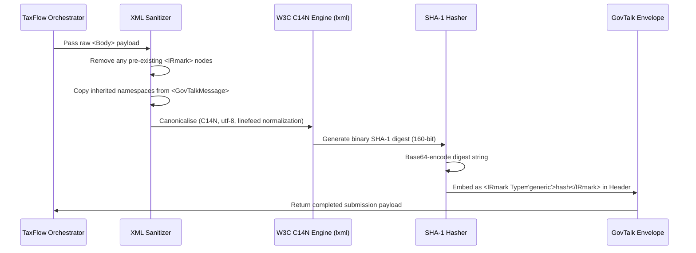

# Document Engine Specification: iXBRL, PDF & Cryptographic Gateways

**Companion Deep-Dive Document for TaxFlow UK Master Implementation Plan**

---

## 1. Executive Summary & Purpose

Statutory document generation represents the most unforgiving component of UK tax and company filing software. A single misaligned namespace, invalid context reference, unrounded penny, or malformed C14N line ending causes instantaneous rejection by HMRC's Transaction Engine (e.g. Error `3001` - XML Schema Validation Failure) or Companies House TIS Gateway.

This document establishes the exact engineering blueprint for:
1. **FRS 105 Micro-Entity iXBRL Generation**: Type-safe XHTML rendering with embedded XBRL semantic micro-tags.
2. **Local Schema Validation**: Using open-source **`Arelle`** and **`lxml`** to validate against FRC UK GAAP and HMRC schemas before transmission.
3. **High-Resolution PDF Generation**: Declarative React-based rendering via **`@react-pdf/renderer`** with dynamic draft watermarking.
4. **W3C C14N Canonicalization & IRmark Hashing**: Exact implementation of HMRC's SHA-1 Base64 cryptographic fingerprint.

---

## 2. FRS 105 iXBRL Architecture & Taxonomy Mapping

### 2.1 The Nature of iXBRL
Inline XBRL (iXBRL) is standard XHTML 1.1 with XBRL semantic tags embedded directly into HTML elements via the `ix:` namespace. A single `.html` document serves as both:
- Human-readable accounts rendered in any standard web browser.
- Machine-readable financial data extracted by HMRC and Companies House ingestion engines.

### 2.2 Namespace Declarations
Every generated FRS 105 micro-entity accounts document must declare the following exact XML namespaces in the root `<html>` element:

```xml
<?xml version="1.0" encoding="UTF-8"?>
<!DOCTYPE html>
<html xmlns="http://www.w3.org/1999/xhtml"
      xmlns:ix="http://www.xbrl.org/2013/inlineXBRL"
      xmlns:ixt="http://www.xbrl.org/inlineXBRL/transformation/2011-08-23"
      xmlns:link="http://www.xbrl.org/2003/linkbase"
      xmlns:xbrli="http://www.xbrl.org/2003/instance"
      xmlns:xlink="http://www.w3.org/1999/xlink"
      xmlns:iso4217="http://www.xbrl.org/2003/iso4217"
      xmlns:uk-gaap="http://www.xbrl.org/uk/fr/gaap/core/2019-01-01"
      xmlns:uk-core="http://xbrl.frc.org.uk/cd/2019-01-01/business"
      xmlns:uk-direp="http://xbrl.frc.org.uk/reports/2019-01-01/direp"
      xmlns:frs-105="http://xbrl.frc.org.uk/frs/105/2019-01-01">
```

### 2.3 Context & Unit Declarations (`<ix:header>`)
The document header defines the temporal contexts and currency units used throughout the financial statements:
1. **`unit_gbp`**: Standard ISO 4217 currency (`iso4217:GBP`).
2. **`unit_pure`**: Pure numeric ratio (`xbrli:pure`) for share counts or employee numbers.
3. **`ctx_current_period`** (Duration): Covers the financial year (e.g. `2025-04-01` to `2026-03-31`). Used for Profit & Loss items (Turnover, Cost of Sales, Tax).
4. **`ctx_current_instant`** (Instant): The balance sheet date (e.g. `2026-03-31`). Used for Balance Sheet items (Cash, Debtors, Net Assets, Capital).
5. **`ctx_prior_period`** / **`ctx_prior_instant`**: Comparative contexts for prior year figures.

### 2.4 The FRS 105 Tagging Catalogue (The 32 Core Concepts)

| Accounting Statement | Taxonomy Concept Name | XBRL Data Type | Context Type | Description |
| :--- | :--- | :--- | :--- | :--- |
| **P&L** | `uk-gaap:TurnoverGrossOperatingRevenue` | Monetary (`GBP`) | Duration | Gross sales / operating revenue |
| **P&L** | `uk-gaap:CostSales` | Monetary (`GBP`) | Duration | Direct costs of raw materials / goods |
| **P&L** | `uk-gaap:StaffCostsEmployeeCosts` | Monetary (`GBP`) | Duration | Gross wages, employer NIC, pensions |
| **P&L** | `uk-gaap:DepreciationAmortisationImpairmentExpense` | Monetary (`GBP`) | Duration | Total depreciation charge for the year |
| **P&L** | `uk-gaap:OtherOperatingChargesExpenses` | Monetary (`GBP`) | Duration | General administrative and office overheads |
| **P&L** | `uk-gaap:TaxTaxCreditOnProfitOrLossOnOrdinaryActivities` | Monetary (`GBP`) | Duration | Corporation Tax provision for the period |
| **P&L** | `uk-gaap:ProfitLossForPeriod` | Monetary (`GBP`) | Duration | Net profit or loss after tax |
| **Balance Sheet** | `uk-gaap:PropertyPlantEquipment` | Monetary (`GBP`) | Instant | Tangible fixed assets net book value |
| **Balance Sheet** | `uk-gaap:Debtors` | Monetary (`GBP`) | Instant | Trade debtors and prepayments |
| **Balance Sheet** | `uk-gaap:CashBankOnHand` | Monetary (`GBP`) | Instant | Bank account balances and petty cash |
| **Balance Sheet** | `uk-gaap:CurrentAssets` | Monetary (`GBP`) | Instant | Total current assets ($\text{Debtors} + \text{Cash}$) |
| **Balance Sheet** | `uk-gaap:CreditorsDueWithinOneYear` | Monetary (`GBP`) | Instant | Trade creditors, tax due, director loan cr |
| **Balance Sheet** | `uk-gaap:NetCurrentAssetsLiabilities` | Monetary (`GBP`) | Instant | $\text{Current Assets} - \text{Creditors < 1 yr}$ |
| **Balance Sheet** | `uk-gaap:TotalAssetsLessCurrentLiabilities` | Monetary (`GBP`) | Instant | $\text{Fixed Assets} + \text{Net Current Assets}$ |
| **Balance Sheet** | `uk-gaap:CreditorsDueAfterOneYear` | Monetary (`GBP`) | Instant | Long term loans (> 12 months) |
| **Balance Sheet** | `uk-gaap:ProvisionsForLiabilities` | Monetary (`GBP`) | Instant | Deferred tax or provisions |
| **Balance Sheet** | `uk-gaap:CalledUpShareCapital` | Monetary (`GBP`) | Instant | Issued nominal share capital |
| **Balance Sheet** | `uk-gaap:ProfitLossAccountReserve` | Monetary (`GBP`) | Instant | Cumulative retained earnings |
| **Balance Sheet** | `uk-gaap:ShareholderFunds` | Monetary (`GBP`) | Instant | Total equity ($\text{Share Capital} + \text{P&L Reserve}$) |
| **Disclosures** | `uk-direp:AverageNumberEmployeesDuringPeriod` | Decimal | Duration | Average statutory employee headcount |
| **Disclosures** | `uk-direp:CompanyEntitledToAuditExemption...` | Boolean / String | Instant | Companies Act 2006 s477 declaration |
| **Disclosures** | `uk-direp:DateApprovalAccounts` | Date (`YYYY-MM-DD`) | Instant | Board accounts approval date |
| **Disclosures** | `uk-direp:NameEntityOfficer` | String | Instant | Name of approving director |

---

## 3. High-Resolution PDF Production Suite

Using **`@react-pdf/renderer`**, the application produces two statutory PDF publications directly in serverless execution without headless Chromium.

### 3.1 Full Accounts PDF (For Directors & Shareholders)
- **Palette & Typography**: Professional Helvetica/Times serif styling conforming to standard UK accounting practice.
- **Section 1: Title & Overview**: Company legal name, CRN, registered office address, director names, reporting period dates.
- **Section 2: Profit and Loss Account**: Clear multi-line revenue, cost of sales, operating expenses, tax, and retained profit.
- **Section 3: Statement of Financial Position (Balance Sheet)**: Formatted comparative balance sheet with current and prior period columns.
- **Section 4: Statutory Footnotes**:
  - Micro-entity accounting basis note (FRS 105 compliance).
  - Employee count note.
  - Directors' advances and guarantees note (details of any overdrawn DLA).
  - Companies Act 2006 s475/s477 audit exemption declarations.
  - Sign-off block with director's electronic signature and approval date.

### 3.2 CT600 Form PDF (HMRC Official Layout)
- Recreates the official 8-page HMRC CT600 Corporation Tax return layout:
  - **Company details**: Box 1 (UTR), Box 2 (CRN), Box 3 (Company Name), Box 30–35 (Period dates).
  - **Tax calculation**: Box 145 (Turnover), Box 155 (Trading Profit), Box 170 (Bank Interest), Box 235 (Total Profits), Box 315/330 (Profits chargeable @ 19%/25%), Box 435 (Marginal Relief), Box 440 (Tax Payable).
  - **Capital allowances**: Box 705 (Main Pool WDA), Box 710 (Balancing charges), Box 726 (Zero-emission cars FYA).
  - **Declaration**: Box 985 (Name), Box 990 (Status), Box 995 (Date).
- Includes **CT600A supplementary pages** for close company loans to participators (s455).

### 3.3 Dynamic Draft Watermarking Engine
Before gateway payment confirmation, all rendered PDF pages embed a semi-transparent, diagonal SVG watermark:
`"DRAFT — PRE-SUBMISSION COPY — FOR REVIEW ONLY"`
Upon successful Stripe payment and gateway submission, the clean, official publication is unlocked and archived.

---

## 4. Cryptographic Submission Engine & IRmark

### 4.1 Statutory W3C C14N Algorithm
HMRC's Transaction Engine requires that the XML body be canonicalised using **W3C Canonical XML (C14N)** without comments (`http://www.w3.org/TR/2001/REC-xml-c14n-20010315`).



### 4.2 Python Validation Sidecar (`services/validator-sidecar`)
A lightweight FastAPI/Python service utilizing **`lxml`** and **`Arelle`**:
- **Endpoint `/validate-ixbrl`**: Takes generated iXBRL HTML, runs it against the FRC FRS 105 taxonomy schema, and returns JSON error reports.
- **Endpoint `/compute-irmark`**: Takes GovTalk submission XML, extracts `<Body>`, computes W3C C14N, and returns the verified Base64 SHA-1 IRmark.
- **Endpoint `/validate-ct600-xml`**: Validates the CT600 payload against the official HMRC SDST XSD schema (`HMRC-CT600-v3.xsd`).
