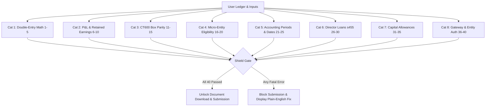

# 40-Point Pre-Flight Rejection Shield & Tax Engine Specification

**Companion Deep-Dive Document for TaxFlow UK Master Implementation Plan**

---

## 1. Executive Summary & Purpose

In tax filing software, catching errors *after* gateway submission damages customer trust and risks statutory penalties. When a user submits an inconsistent return, HMRC returns opaque XML rejection errors (e.g., `Error 3001: The submission failed schema validation`) without identifying the human error.

The **40-Point Pre-Flight Rejection Shield** is TaxFlow UK's core competitive moat over TinyTax. It acts as an automated pre-submission firewall executing 40 strict compliance checks across mathematical consistency, taxonomy validity, period dates, capital allowances, director loans, and gateway credential formats. Submissions are strictly locked until all fatal rules evaluate to `PASS`.

---

## 2. The 40-Point Pre-Flight Validation Rule Catalogue

### Category 1: Double-Entry Mathematical Balancing (Rules 1–5)
- **Rule 01 [FATAL]**: $\text{Net Assets} \equiv \text{Total Shareholders' Funds}$. Fixed Assets + Current Assets - Creditors (<1yr) - Creditors (>1yr) - Provisions must equal Called-up Share Capital + P&L Reserve down to the exact integer penny (£0.00 variance).
- **Rule 02 [FATAL]**: $\sum \text{Debits} - \sum \text{Credits} \equiv 0$ across all imported trial balance ledger accounts.
- **Rule 03 [FATAL]**: Called-up share capital must be $\ge £1.00$ for an active private company limited by shares.
- **Rule 04 [WARN]**: Overdrawn cash account ($\text{Cash} < £0.00$) flags that bank overdraft should be classified under Creditors (<1yr) rather than negative cash.
- **Rule 05 [WARN]**: Negative debtors or negative creditors flag possible misclassification of receivables and payables.

### Category 2: Retained Earnings Roll-Forward & P&L Reconciliation (Rules 6–10)
- **Rule 06 [FATAL]**: $\text{Closing P&L Reserve} = \text{Opening P&L Reserve} + \text{Net Profit After Tax} - \text{Dividends Declared}$.
- **Rule 07 [FATAL]**: Illegal Dividend Guard: Dividends declared must NOT exceed available distributable reserves ($\text{Opening P&L Reserve} + \text{Current Net Profit After Tax}$).
- **Rule 08 [FATAL]**: Turnover on P&L must exactly match Box 145 on CT600.
- **Rule 09 [FATAL]**: Corporation Tax Expense on P&L must equal CT600 Box 440 tax payable (or include deferred tax reconciliation).
- **Rule 10 [WARN]**: Operating expenses exceed turnover by $>500\%$ flags check for potential revenue omission.

### Category 3: CT600 Box Parity & Marginal Relief (Rules 11–15)
- **Rule 11 [FATAL]**: $\text{CT600 Box 235 (Total Profits)} = \text{Box 155 (Trading Profit)} + \text{Box 170 (Bank Interest)}$.
- **Rule 12 [FATAL]**: If Augmented Profits ($A$) $\le L$, tax must equal $TTP \times 19\%$ exactly. Box 315 populated; Box 330 and Box 435 must be £0.
- **Rule 13 [FATAL]**: If Augmented Profits ($A$) $\ge U$, tax must equal $TTP \times 25\%$ exactly. Box 330 populated; Box 315 and Box 435 must be £0.
- **Rule 14 [FATAL]**: If $L < A < U$, Marginal Relief (Box 435) must equal $\frac{3}{200} \times (U - A) \times \frac{TTP}{A}$ rounded to integer pence. $\text{Box 440} = \text{Box 330} - \text{Box 435}$.
- **Rule 15 [FATAL]**: Franked Investment Income (exempt distributions) must be added to Augmented Profits ($A$) but EXCLUDED from Total Taxable Profits ($TTP$).

### Category 4: Micro-Entity Statutory Qualification (Rules 16–20)
- **Rule 16 [FATAL]**: Two-of-Three Test: Check Turnover $\le £1,000,000$, Balance Sheet $\le £500,000$, Employees $\le 10$. If 2 of 3 exceeded, hard block micro-entity filing.
- **Rule 17 [FATAL]**: Entity Exclusions: Company must not be a public company (PLC), charity, financial institution, or member of an ineligible group.
- **Rule 18 [FATAL]**: Average employee count must be an integer between 0 and 10.
- **Rule 19 [FATAL]**: Dormant Company Check: If company is flagged "Dormant", turnover and all P&L operating expense lines must be strictly £0.
- **Rule 20 [WARN]**: Balance sheet total near threshold ($>£450,000$) warns director of impending FRS 102 transition.

### Category 5: Accounting Periods & Statutory Dates (Rules 21–25)
- **Rule 21 [FATAL]**: Corporation Tax accounting period must NOT exceed 12 months (366 days in leap year). Split automatically if longer.
- **Rule 22 [FATAL]**: Period Start Date must immediately follow prior filed period End Date (zero gap, zero overlap).
- **Rule 23 [FATAL]**: Payment Due Date must be exactly 9 months and 1 day following period end date.
- **Rule 24 [FATAL]**: Accounts Approval Date must be on or after the balance sheet date and on or before current filing date.
- **Rule 25 [WARN]**: Filing within 14 days of statutory filing deadline displays late filing warning banner.

### Category 6: Director's Loan Account (s455) & CT600A (Rules 26–30)
- **Rule 26 [FATAL]**: If DLA is overdrawn at balance sheet date, loan advance date must be captured for each individual loan.
- **Rule 27 [FATAL]**: Loans made on/after 6 April 2026 must be charged at 35.75%; loans between 6 April 2022 and 5 April 2026 must be charged at 33.75%.
- **Rule 28 [FATAL]**: Bed-and-breakfasting anti-avoidance: Repayments of £5k+ followed by redrawing within 30 days must be disallowed from relief.
- **Rule 29 [FATAL]**: Multi-loan advances must generate corresponding multi-line entries on CT600A supplementary pages.
- **Rule 30 [WARN]**: Overdrawn DLA flags statutory disclosure requirement in balance sheet notes.

### Category 7: Capital Allowances & Add-Backs (Rules 31–35)
- **Rule 31 [FATAL]**: Cars cannot claim AIA or Full Expensing. Must be pooled into Main Pool (14%) or Special Rate Pool (6%).
- **Rule 32 [FATAL]**: Zero-emission car 100% FYA must be date-gated to acquisitions prior to 31 March 2027.
- **Rule 33 [FATAL]**: Main Pool WDA for straddling periods must apply the day-weighted hybrid formula: $(\text{Days pre-Apr 26} \times 18 + \text{Days post-Apr 26} \times 14) / \text{Total Days}$.
- **Rule 34 [FATAL]**: Depreciation recorded on P&L must be 100% added back in the tax computation.
- **Rule 35 [FATAL]**: Client entertaining expenditure must be 100% added back in the tax computation.

### Category 8: Gateway Credentials & Identity Verification (Rules 36–40)
- **Rule 36 [FATAL]**: Company UTR must be exactly 10 numeric digits.
- **Rule 37 [FATAL]**: Companies House Registration Number (CRN) must be exactly 8 characters (alphanumeric, padded with leading zeroes).
- **Rule 38 [FATAL]**: Companies House Authentication Code must be exactly 6 alphanumeric characters.
- **Rule 39 [FATAL]**: Government Gateway User ID (12 digits) and password must be non-empty.
- **Rule 40 [FATAL]**: Director electronic declaration checkbox must be ticked, with full director name recorded.

---

## 3. Plain-English Gateway Error Translation Catalogue

When a gateway does reject a submission (e.g. during manual testing or due to external HMRC account issues), the platform translates the raw XML error codes into plain-English instructions:

| Gateway Code | Raw Gateway Message | Plain-English User Explanation | Actionable Remediation Step |
| :--- | :--- | :--- | :--- |
| **HMRC 1046** | `Authentication Failure. The supplied credentials failed validation.` | **HMRC Login Credentials Invalid** The Government Gateway User ID, password, or Company UTR does not match HMRC's records. | 1. Log in to your HMRC Business Tax Account directly. 2. Verify Corporation Tax is enrolled. 3. Verify your 10-digit Company UTR. |
| **HMRC 3001** | `The submission failed schema validation.` | **Technical Data Format Discrepancy** One of the fields contains an unexpected character, invalid date format, or mismatched taxonomy tag. | Our system highlights the specific field in red with a 1-click auto-format button. |
| **HMRC 4065** | `Accounting period start date does not match HMRC records.` | **Accounting Period Date Mismatch** HMRC expects an accounting period starting on a different date than entered. | Verify the Notice to Deliver a Company Tax Return (form CT603) issued by HMRC for the exact dates. |
| **HMRC 9999** | `Internal gateway processing error.` | **HMRC System Temporary Interruption** HMRC's backend servers experienced a temporary timeout. | Our submission worker automatically reschedules a polling request in 10 minutes without duplicate filing risk. |
| **CH 9999** | `Authentication failed for company [CRN].` | **Companies House Authentication Code Incorrect** The 6-character authentication code entered for this company is incorrect. | Check the official Companies House letter sent to your registered office containing your 6-character code. |
