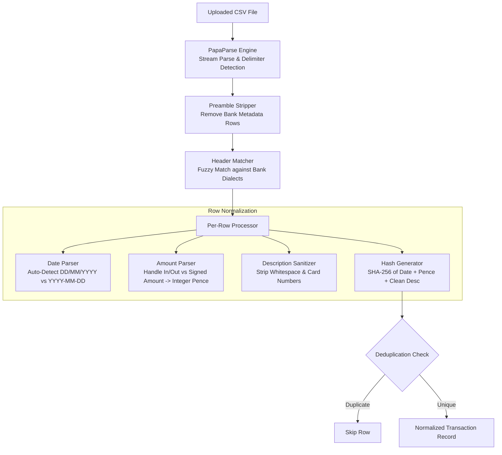
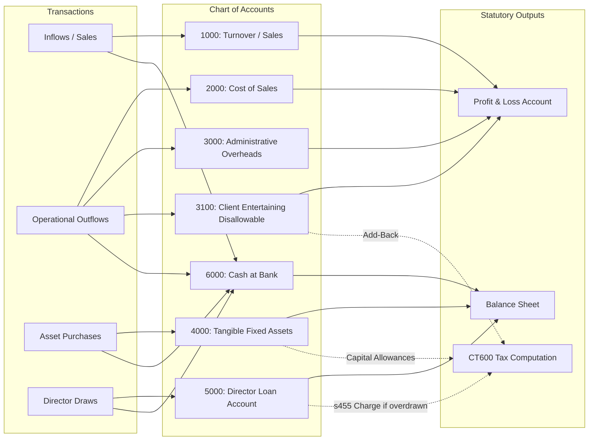

# Ingestion Engine & Universal Bank CSV Normalizer Specification

**Companion Deep-Dive Document for TaxFlow UK Master Implementation Plan**

---

## 1. Executive Summary & Purpose

A major failure point in DIY tax software is messy source data. Micro-entity directors do not maintain pristine Double-Entry ledgers; they download raw CSV exports from their banking apps (Monzo, Starling, Barclays, Revolut, etc.) or export unstandardized spreadsheets.

The **TaxFlow UK Ingestion Engine** bridges messy bank statements to clean, statutory FRS 105 accounts via:
1. **Universal Bank CSV Normalizer**: Multi-dialect parser detecting and standardizing date formats, amount conventions, and transaction descriptions.
2. **Trial Balance CSV Ingestor**: For bookkeepers and users exporting from Xero, QuickBooks, FreeAgent, or Excel.
3. **Double-Entry Ledger & Chart of Accounts Engine**: Deterministic classification into FRS 105 taxonomy buckets.
4. **Transaction Deduplication**: Cryptographic hashing of date + amount + description to prevent duplicate imports.

---

## 2. UK Bank CSV Dialect Matrix

Different UK banks format their transaction exports with varying column headers, date structures, and debit/credit sign conventions:

| Bank | Date Format | Transaction Amount Structure | Header Names | Specific Dialect Quirks |
| :--- | :--- | :--- | :--- | :--- |
| **Monzo** | `YYYY-MM-DD` | Single `Amount` column (Negative = Debit, Positive = Credit) | `Date, Time, Type, Name, Emoji, Category, Amount, Currency, Local amount, Local currency, Notes and #tags, Address, Receipt, Description, Category split` | Includes emoji column and local currency columns. Amount is in standard decimals (`-15.00`). |
| **Starling** | `DD/MM/YYYY` | Single `Amount` column (Negative = Debit, Positive = Credit) | `Date, Counter Party, Reference, Type, Amount (GBP), Balance (GBP), Spending Category, Notes` | Amount header includes `(GBP)`. Standard date format. |
| **Barclays** | `DD/MM/YYYY` | Single `Amount` column or split `Money In` / `Money Out` | `Number, Date, Account, Amount, Subcategory, Memo` | Often includes blank disclaimer rows at top of file that must be skipped. |
| **NatWest / RBS** | `DD/MM/YYYY` | Split `Paid in` / `Paid out` columns | `Date, Type, Description, Value, Balance, Account Name, Account Number` | Uses `Value` with sign or separate credit/debit columns depending on export view. |
| **Lloyds / Halifax**| `DD/MM/YYYY` | Split `Debit Amount` / `Credit Amount` | `Transaction Date, Transaction Type, Sort Code, Account Number, Transaction Description, Debit Amount, Credit Amount, Balance` | Currency symbols (`£`) occasionally prepended in amounts. |
| **HSBC** | `DD/MM/YYYY` | Single `Amount` column with signed values | `Date, Payment Type, Details, Paid Out, Paid In, Balance` | Multi-line transaction details must be sanitized. |
| **Revolut Business**| `YYYY-MM-DD` | Split `Amount` and `Fee` columns | `Started Date, Completed Date, Description, Amount, Fee, Currency, State, Balance` | Two date columns; must strictly use `Completed Date` for accounting tax point. |

---

## 3. The Universal Normalization Algorithm



### 3.1 Normalization Output Schema
Every ingested row maps to this strictly-typed internal record:
```typescript
export interface NormalizedTransaction {
  id: string;                      // UUID
  companyId: string;
  sourceBank: string;              // e.g. "Monzo", "Barclays", "Generic"
  transactionDate: string;         // ISO YYYY-MM-DD (UTC)
  rawDescription: string;
  cleanDescription: string;
  amountPence: number;             // Signed integer pence (Positive = Credit/Inflow, Negative = Debit/Outflow)
  categoryBucket: AccountingBucket;
  isDisallowable: boolean;         // true for Client Entertaining, Fines
  isCapitalAsset: boolean;         // true for Computers, Plant & Machinery
  rawRowHash: string;              // SHA-256 deduplication fingerprint
}
```

---

## 4. Double-Entry Chart of Accounts Mapping

Normalized transactions automatically aggregate into standard FRS 105 reporting buckets:



### 4.1 Automatic Disallowable Flagging
When descriptions match known non-deductible patterns (e.g., `Restaurant`, `Pub`, `Dinner`, `Costa`, `Starbucks`, `Uber Eats`, `Parking Fine`, `HMRC Penalty`), the system automatically suggests the category **`Client Entertaining (Disallowable)`** or **`Fines & Penalties (Disallowable)`**.
- A prominent badge displays: *"This expense will be added back for Corporation Tax calculation."*
- Director can confirm or reclassify with a single click.
